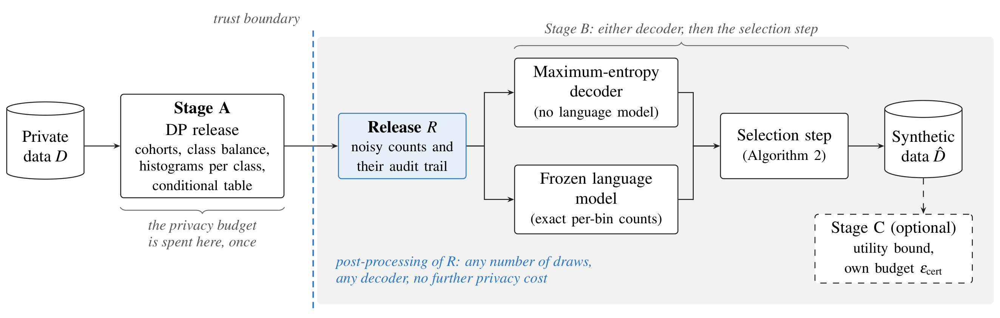

# CoRTeC

**A differentially private release for synthetic tabular data, decodable by any generator.**



The records that could train the most useful models, such as a hospital's patient files, are often the ones an
institution cannot share. We propose CoRTeC, a method that lets others learn from such records without seeing anyone
in them, by releasing synthetic data under differential privacy. CoRTeC spends the privacy budget once on a small
release of noisy counts designed for training a classifier. For each cohort of the data the release gives the cohort's
size, its class balance, a histogram of every attribute for each outcome class and the outcome rate in a set of
non-overlapping cells. A reviewer can check every one of these numbers before the release leaves the institution.

Everything after the release is post-processing, so it costs no further privacy. A maximum-entropy decoder can turn
the counts into rows with no language model at all. A frozen language model can do the same. It reads only the release
and writes rows that carry exactly the counts it is asked for. A selection step then matches the decoded rows to the
released counts. Because no model ever sees a private record, generation can be repeated as often as needed on any
model, even one behind an interface the institution does not control.

## Documents

| Document | What it is |
|---|---|
| [The paper](paper/CoRTeC_arxiv.pdf) | The mechanism, its privacy analysis, and the measurements with their controls (12 pages of main text, appendices A to G) |
| [The deployment guide](paper/CoRTeC_deployment_guide.pdf) | The architecture, the parameters, the full prompt, a checklist, the controls mapped to standards, the failure modes with their guards, and the cost (8 pages) |

## What the paper finds

- **The release on its own is enough to train useful models, with no language model.** At ε = 2 with 300 and 1,000
  rows, we decode the auto-configured release with the maximum-entropy model and the selection step (`cortec decode`).
  Over three splits it trains every student classifier to within 0.02 AUC of a real sample of the same size on UCI
  Adult. With the fixed cohort rule, the decoded rows carry the conditional rates the release names more closely than
  such a sample does, once they pass through the selection step. On NHANES and bank marketing the gap to a real sample
  is larger, reaching 0.07 AUC on the medical dataset at 300 rows. - **The language model's contribution comes from
  the column names.** It repairs pairs of columns it recognises and invents links between columns that are nearly
  independent. When every name is replaced by a neutral token it loses that advantage. Without the release it recites
  the public file. Most of the gain over the maximum-entropy decoder alone comes from the selection step, not from the
  model. - **What the fixed workload costs.** The release spends its budget on the conditional rates a deployment
  names. This costs accuracy on pairs of columns, which an adaptive workload such as AIM's fits more closely. On
  utility the release reaches the reference AIM in five of six settings. Our draws are at most 1,000 rows. CoRTeC is
  meant to sit beside the marginal methods, so choose whichever fits your deployment. - **The privacy architecture
  holds in every test.** One release serves any number of draws, and the backbone can be replaced at no privacy cost.
  The strongest membership attack on any CoRTeC configuration reaches an advantage of 0.02 to 0.05 against the 0.762
  the budget permits. No synthetic row copies a training row. The part of the Adult file that the served model has
  memorised never reaches a draw.

## Install

You need Python 3.10 or later. The package is not on PyPI, so install it from a clone of this repository. One
install gives two packages and two commands. `cortec` covers Stages A, B and C. `cortec_hybrid` corrects a marginal
synthesiser's output without a language model.

```bash
git clone https://github.com/Calyie/cortec
cd cortec
pip install '.[gemini]'        # Gemini (also the `vertex` extra for Google Vertex AI)
pip install '.[openai]'        # GPT, Azure OpenAI, and any server with an OpenAI-compatible interface (vLLM)
pip install '.[anthropic]'     # Claude (also the `bedrock` extra for AWS Bedrock)
pip install '.[pgm]'           # decode a release with no language model (Private-PGM and JAX)
pip install '.[dev]'           # pytest and scikit-learn, for the tests and the evaluator
python3 -m pytest tests -q     # offline, and every test is named after the defect it prevents
```

## Quick start

The schema declares only public knowledge: the columns, their bounds, the bin edges and the target.

```python
from cortec import Schema, release_statistics, Generator

schema = Schema(
    name="encounters",
    numerical={"age": (18, 95), "length_of_stay": (1, 30)},
    categorical={"admission_type": ["Emergency", "Elective", "Urgent"]},
    target="readmitted_30d", positive="YES", negative="NO",
    bins={"age": [18, 40, 55, 70, 95], "length_of_stay": [1, 3, 6, 10, 30]},
)                                                     # no `conditional`: the hierarchy is derived

release = release_statistics(schema, private_df, epsilon_total=2.0, n_min=150,
                             max_rows_per_person=1)   # Stage A: the only code that sees private_df
release.to_json("release.json")                       # contains no private record

gen = Generator(schema, backend="gemini", model="gemini-3.5-flash", reasoning="on")
synthetic = gen.generate_selected(release, n_rows=1000, pool_factor=3)   # Stage B: post-processing
```

`cortec run --data private.csv --schema my_schema.py --backend gemini` runs the three stages on a table from the
command line. `cortec decode --schema my_schema.py --release results/<name>/release.json` decodes the same release
with no language model, using Private-PGM and the selection step (it needs the `pgm` extra). `cortec --help` lists
everything you can run. The setup guide in [`docs/setup.md`](docs/setup.md) walks through each step. It covers where
the model runs and its credentials, the data, the schema, the release and its audit, generation and selection, the
utility bound, the evaluation and what to do about each refusal. To use a self-hosted model behind an
OpenAI-compatible server, set `backend="openai"` and `OPENAI_BASE_URL`. The paper's Qwen3 runs worked this way through
vLLM.

**Where this should run.** For regulated data, use the enterprise-hosted, tenant-isolated surface in your own cloud
account (Vertex AI, Azure OpenAI or Bedrock) or a model on your own hardware. The vendors' public developer APIs are
supported, but we do not recommend them for regulated data. The weights are the same but the contract and the network
path are not. The privacy argument does not depend on the endpoint because the request carries only the release. The
compliance argument does.

## Reproducing a CoRTeC result from the paper

The research pipeline that produced every CoRTeC result is under [`research/`](research/). The datasets are downloaded
from public sources the first time they are used. They are cached under `research/data/`, which is not committed.

```bash
pip install -r research/requirements.txt
cd research
python3 run_dataset.py --dataset adult --stage generate --backend gemini --model gemini-3.5-flash \
    --n-synthetic 300 --draws 3 --rows-per-call 25 --epsilon-total 2.0 --cond-frac 0.2 --n-min 150 \
    --quota --pool-factor 3 --seed 42 --skip-header-only --no-by-cell --outdir results/adult_gemini
python3 evaluate_generic.py --dataset adult --spec-json <configurations.json> --seed 42
```

A release already in the output directory is reused rather than drawn again, so further draws cost no privacy budget.
Released statistics cannot be regenerated bit for bit because the noise source ignores any seed. For the same reason
the frozen auto-configurations under `research/results/autoconfig/` are reused by file. The reference-AIM wrapper, the
maximum-entropy decoder with and without the selection step, the one-shot control, the anonymisation of releases and
the scorers are all under `research/controls/`. The synthetic draws, the score files and the stored releases of every
configuration are deposited with the paper's Zenodo record (DOI 10.5281/zenodo.22945315).

## Repository layout

| Path | Contents |
|---|---|
| `src/cortec/`, `src/cortec_hybrid/` | The two packages, Apache-2.0 |
| `tests/` | Their tests, offline |
| `docs/` | The setup guide, the hybrid's guide, the design notes (the measurements behind the defaults) and the result format |
| `examples/example.py` | A runnable tour of the three stages with no API key |
| `paper/` | The paper and the deployment guide as PDFs, with the figures |
| `research/` | The pipeline driver, the evaluator, the Stage C script, the membership-inference script, the dataset specifications and the frozen auto-configurations |
| `research/controls/` | The paper's controls: the reference AIM and MST wrapper with its corrected sampler, the maximum-entropy decoder of a release alone and with the selection step, the one-shot control, the anonymisation of a release and its draws, the per-pair scorer and the three paper-protocol scorers |
| `research/results/development/` | The files behind the one development measurement the design notes quote with its own data: an unconditioned model's readmission rate (98.5%) against the real rate (21.4%), with a script that recomputes both |

## Where the guarantee does not hold

- **ε protects one row, not one person.** A person who contributes `k` rows receives `k · ε`. Cap each person's rows
  before Stage A. The library requires the number of rows per person and refuses a value that makes the guarantee
  meaningless.
- **Floating-point Laplace.** The library's noise is vulnerable to the Mironov (2012) attack on the low bits of the
  sampled noise.
- **Pretraining provenance.** The guarantee says nothing about the model's training corpus. The paper's memorisation
  tests and membership attacks are the measured evidence.
- **Endpoint.** The paper's measurements used the public developer APIs and self-hosted models, not the enterprise
  surfaces recommended above.

## AI use

Language models appear in this work as the objects of study: they are the backbones named in the paper's tables.
Language-model assistants were also used to draft and edit the text and the code in this repository. Every experiment
was designed, run and checked by the author, and every number in the documents was produced by the described pipeline
from stored result files.

## Citation and licence

See [`CITATION.cff`](CITATION.cff). The licence is Apache-2.0 (see [`LICENSE`](LICENSE)).
