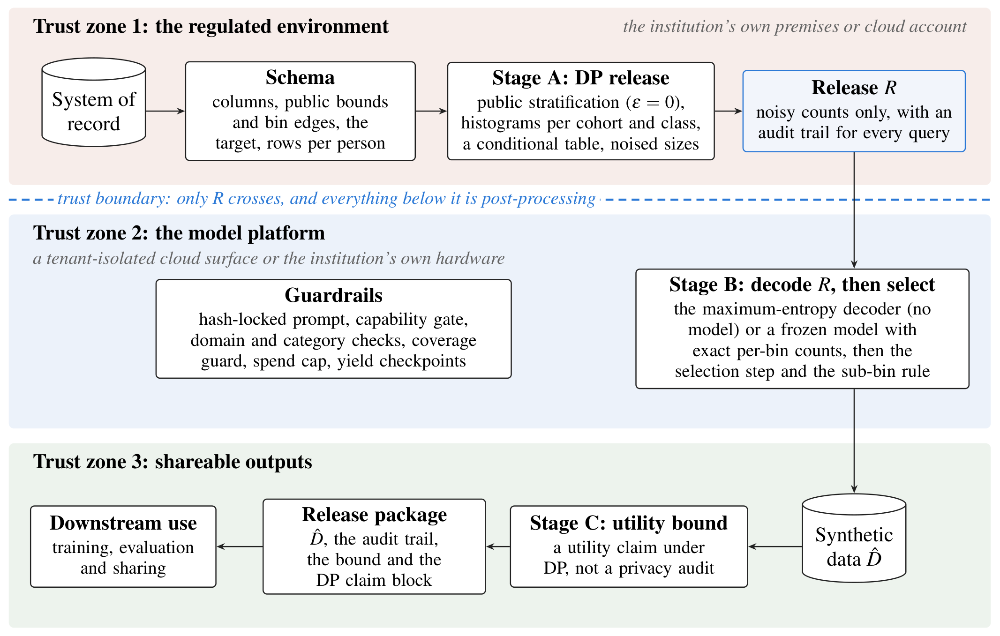

<!-- math: on -->
# CoRTeC Deployment Guide

<div class="authors">
<p><b>Calister Nnona</b></p>
<p>calisternnona@gmail.com</p>
<p>DOI: <a href="https://doi.org/10.5281/zenodo.22945315">10.5281/zenodo.22945315</a></p>
</div>

<div class="abstract">
<p><b>Scope.</b> This guide covers what a team needs to deploy CoRTeC: the trust boundary and what crosses it, the reference implementation and its surfaces, the parameters, the prompt, a checklist, the controls mapped to standards, the failure modes the implementation guards against, and the cost. The method, its privacy analysis and the measurements are in the paper (<a href="https://github.com/Calyie/cortec/blob/main/paper/CoRTeC_arxiv.pdf">CoRTeC_arxiv.pdf</a>). The implementation, the packages <code>cortec</code> and <code>cortec_hybrid</code> at version 1.2.0 under Apache-2.0, is in the same repository, <a href="https://github.com/Calyie/cortec">Calyie/cortec</a>, with the pipeline that produced the paper's CoRTeC arms.</p>
</div>

## 1. Architecture

{: .wide}

**Figure 1.** Trust zone 1 is the institution's regulated environment, where Stage A runs. Trust zone 2, the tenant-isolated model platform, runs Stage B on the release alone. Trust zone 3 holds the synthetic data, the Stage C bound and the release package. Only one arrow crosses the trust boundary, and it carries the release $R$.

$R$ is a differentially private release of counts. Stage A groups the rows into cohorts by a public rule and, for each cohort, releases with Laplace noise the cohort's size, its class balance, one histogram per attribute for each outcome class, and a table of outcome rates over cells that do not overlap. Everything below the boundary (generation, selection, the sub-bin rule, evaluation) reads $R$ and its own output only. It is post-processing: it can be repeated without limit, by another team, at any later time, at no further privacy cost (paper, Theorem 1 and Appendix A).

Trust Zone 2 is the enterprise surface, not a public API endpoint. We do not recommend the vendors' public developer APIs for a deployment. The recommendation is Claude on AWS Bedrock, GPT on Azure OpenAI, or Gemini on Google Vertex AI, in the institution's own account under its own contract, or an air-gapped model on the institution's own hardware. The privacy argument holds against any endpoint, because the request carries only $R$; the compliance argument (tenant isolation, private networking, data residency, a business associate agreement) is contractual and is the institution's to verify. The endpoint we measured is not the endpoint we recommend: the paper's Gemini results come from the direct public developer APIs and its Qwen3 results from a locally served model. Every capability result is a property of the model weights and the prompt, and the same weights are served on both surfaces; on one clinical dataset the two surfaces of one vendor were measured against each other with one release and three draws each, and no metric separated them. The contractual side was never exercised by our runs.

**Table 1.** What the architecture provides, against the alternatives.

| | CoRTeC | DP-SGD fine-tuning | AIM, MST | Tab-PE |
|---|---|---|---|---|
| what reaches the compute | the release only; the model decodes it | the private rows, and the trained model is the generator | the private rows, and the fitted model is the generator | the private rows, every iteration |
| where compute may run | anywhere | inside the regulated zone | inside the regulated zone | inside the regulated zone |
| a second dataset | no ε; generation cost | no ε; re-sample | no ε; re-sample | a new run and budget |
| a changed generator | no ε; re-generate | retrain | not applicable | not applicable |
| setup | seconds | hours on a GPU | seconds to hours | minutes |

The marginal methods pay once and sample freely. The reference AIM is ahead of CoRTeC on pairwise fidelity and, against the release built by the fixed cohort rule, on utility at larger sizes; the auto-configured release, decoded with no model and the selection step, is level with or ahead of AIM on utility (paper, Section 6). Seen from AIM's side, the release is a fixed workload, a set of measurements chosen before the data is seen, decoded by the estimator AIM uses: AIM chooses its measurements adaptively and wins on pairs; the fixed workload gives the conditionals the deployment names, an artefact a reviewer can inspect cell by cell, and a release that takes seconds. CoRTeC's advantage is where the compute may run and what it sees.

## 2. Deployment

```python
from cortec import Schema, Band, release_statistics, Generator

schema = Schema(
    name="encounters",
    numerical={"age": (18, 95), "length_of_stay": (1, 30)},
    categorical={"admission_type": ["Emergency", "Elective", "Urgent"],
                 "a1c_result": ["None", "Norm", ">7", ">8"]},
    target="readmitted_30d", positive="YES", negative="NO",
    bins={"age": [18, 40, 55, 70, 95], "length_of_stay": [1, 3, 6, 10, 30]},
    stratify=[("length_of_stay", [Band("los1-2", 1, 3), Band("los3-5", 3, 6),
                                  Band("los6+", 6, 31)])],
    conditional=[("admission_type",), ("admission_type", "a1c_result")],
)

release = release_statistics(schema, private_df, epsilon_total=2.0, n_min=150)
release.to_json("release.json")

gen = Generator(schema, backend="gemini", surface="vertex",
                model="gemini-3.6-flash", reasoning="on")
synthetic = gen.generate_selected(release, n_rows=5000, pool_factor=3)
print(gen.stats.calls_with_reasoning_block, "of", gen.stats.calls, "calls reasoned")
```

The schema declares only what is known without looking at the data: column names, public bounds and bin edges, the target, the cohort rule and the conditional levels; `cortec.autoconfig.derive()` derives the last two and charges the one step that reads private data. `release_statistics` is the only call that touches private data. `generate_selected` runs Stage B with the shipped defaults. The command-line forms are `cortec run`, `cortec decode` and `cortec-hybrid run`; the setup guide (docs/setup.md) gives the steps for each surface, the data, the schema, Stages A to C and the evaluator.

**Surfaces.** `surface` is `bedrock`, `azure` or `vertex`; it swaps the client class, the credential flow and the model identifier the surface expects, and nothing else. A mismatched surface or a missing setting fails before a client exists. The tests build the vendors' real client classes offline and replace only the transport. That verification used each vendor's public developer API, not its enterprise surface. One surface is verified live: Gemini 3.5 Flash on Vertex AI (the identifier now served by Gemini 3.6 Flash), through a service account holding `roles/aiplatform.user` only, in the `global` location. Bedrock and Azure OpenAI are not verified live; treat the first run on either as that test. A vendor refusal that will not resolve by retrying (credit, quota, authentication, permissions) aborts immediately. A local model is reached through the `ollama` backend or any OpenAI-compatible server; the paper's Qwen3 arms ran through vLLM.

**The hybrid.** An institution that already runs AIM or MST and will put no language model in the data path can keep its synthesiser, release a DP conditional table and relabel the target column only (`cortec-hybrid`). This is post-processing of two private artefacts. It improved conditional calibration on every dataset tried and moved downstream utility in both directions; the tool reports whether it helped and says when the budget is better not spent.

## 3. Parameters and the release artefact

One fifth is the shipped default for the conditional share; `k = 3` is the shipped default pool factor; each batch asks for what the cohort still owes after the rows already accepted.

**Table 2.** Shipped parameters.

| parameter | default | reason |
|---|---|---|
| $ε_{total}$ | 2.0 | the budget the paper compares architectures at: a conditional cell at the suppression floor carries its rate to within about 0.1, against about 0.2 and 0.4 at ε = 1 and 0.5 (paper, Section 5); the paper also reports 0.5 and 1 |
| conditional share $α$ | 0.2 | a fifth costs no measurable conditional accuracy once the release carries class blocks |
| count share $γ$ | the package: 0.05 of the available budget plus min(0.05 of it, 0.25 of the marginal share), half to cohort sizes and half to cell supports; the paper's tables rest on the research pipeline's γ = 0.02 with the gate charged inside the same count query | cohort sizes and cell supports are private counts; every $n_{min}$ decision reads them; the package spends more on them than the paper's runs did, which is the conservative side |
| suppression floor $n_{min}$ | 150 (refused below 50) | a rate over fewer than about 50 records is dominated by its own noise |
| batch size | 25 rows | the largest batch on which frontier models reproduce every count line |
| counts per outcome class | on | stated as totals, generators followed the class blocks unevenly |
| pool factor $k$ | 3 (2 on a dataset of a few thousand rows) | the selection's gain saturates between 2 and 3 |
| pool coverage floor | 1.1 times the rows each cohort owes | a pool that stopped early starved the late cohorts while every row check passed |
| cell-wise coverage floor | 90 % of each conditioning column's released mass | between the highest failing (0.858) and lowest passing (0.911) measurement |
| sub-bin rule | `release` | the model placed values inside bins to its own prior; the redraw changes no bin count |
| integer columns | from the public edges and bounds plus the majority of the pool (1.1.1) | one "45.0" re-typed a column and delivered fractional values |
| reasoning | `on` | suppressing it moved conditional error 3.8 times in the measurements of the 9 October 2026 version [8]; the current paper does not repeat that measurement, and its open backbones ran at their default settings |
| Stage C tolerance $τ$ | $\ln(k/α)/(n_{min} ε_{cert}) + \frac{1}{2}\max_c |\tilde{ρ}_c − \bar{ρ}|$ | halfway between the noise term and the permuted floor's limit, from released quantities only |
| Stage C minimum rows per cell | 20 | below it a cell rate moves by a third on three rows |

**The release artefact** is a JSON document with no private record: per cohort the published size, class balance and one histogram per attribute and outcome class (or one pooled histogram where a class fell below $n_{min}$); per conditional level each surviving cell's published positive count, size and rate; an audit block with every query's ε, sensitivity, composition rule and partition key, the totals (`epsilon_accounted` per row, the privacy unit with `max_rows_per_person` and `epsilon_per_person`, pure ε, central, δ = 0, add/remove adjacency), and a documented-gaps block (floating-point Laplace, pretraining provenance, an undeclared privacy unit). The ledger seals after release. The artefact cannot be regenerated: the noise source ignores any seed, so the stored file is the only copy, every draw reuses it by file, and the generator verifies it by hash before every run.

## 4. The prompt

The system message and the cohort template are fixed and fingerprinted; a different template must be registered under a new version. Every value in every block is a released quantity. In a cohort with class blocks the numerical and categorical blocks are given once per outcome class.

```
SYSTEM
You generate synthetic tabular records for privacy research. You will be
given summary statistics that were computed under differential privacy.
Reproduce the distributions and relationships they describe as closely as
you can, EVEN IF THIS CONTRADICTS YOUR EXPECTATIONS about how these
variables usually relate. The statistics describe this specific
population; your general knowledge does not. Output only CSV rows. No
commentary, no explanation, no markdown fences.

USER
Generate exactly {n_rows} synthetic records for the following subgroup.

SUBGROUP: {cohort_name}

These statistics were measured on the real data for THIS subgroup, under
differential privacy. Match them. Where a statistic below conflicts with
what you would otherwise expect, follow the statistic: it is a
measurement of the actual population and your expectation is not.

NUMERIC DISTRIBUTIONS (released histograms; reproduce the shape, not just
the mean)
{numeric_block}

CATEGORICAL DISTRIBUTIONS (all released categories and their proportions)
{categorical_block}

OUTCOME RATE IN THIS SUBGROUP
{class_balance_block}

CONDITIONAL OUTCOME TABLE (P({target} = {positive} | cell), measured under
differential privacy)
This table is the most important part of this prompt. Each row states the
outcome rate for a specific cell of the population. Your generated records
must reproduce these rates, even where a rate is the opposite of what you
would expect for that group.
{conditional_block}

EXACT COUNTS FOR THIS BATCH (the number of rows, out of {n_rows}, that
must fall in each bin, each category and each outcome; these are the
counts this subgroup still owes)
{counts_block}

OUTPUT FORMAT
Exactly {n_rows} CSV data rows, plus one header row, with these columns in
this order:
{columns}

Rules:
  - every numeric value must lie within its stated range
  - {target} must be exactly "{positive}" or "{negative}"
  - do not repeat identical rows; vary records the way real data varies
  - output nothing except the header and the {n_rows} data rows
```

Two elements are essential and their removal is not visible in the output: the conditional table, which is the only channel for the conditional structure, and the instruction to follow the statistics against expectation, without which the model emits its prior. On a schema the model does not know, expect the result of the maximum-entropy decoder of the release (paper, Section 4.2), which Private-PGM computes from any release at no privacy cost; the decoder is in the package as `cortec decode` (the table fitted and its pool passed through the selection step), which comes within 0.01 of the best language-model arm on single columns with no model, over three splits (paper, Table 6).

## 5. Checklist

1. **Declare the schema from public knowledge only**: columns, domain bounds, bin edges from clinical or regulatory convention, the target. Bands must tile the declared domain with the top band closed at its upper edge. Never use quantiles of the file.
2. **Set the privacy unit.** If each person has one row, $ε_{person} = ε_{row}$. Otherwise cap each person's contribution to their first $C$ rows before Stage A ($ε_{person} = C ε_{row}$; this leaves the estimand alone), or aggregate to one row per person (this changes the estimand), or report $ε_{person} = k_{max} ε_{row}$ and make no per-person claim. The bound tool requires `--max-rows-per-person`; the implementation refuses a declared unit whose $ε_{person}$ exceeds 10 unless the caller acknowledges it into the audit trail. Capping shrinks cells, so re-check step 5 after it.
3. **Choose ε and $n$.** Take the tightest budget the regulator accepts. The release's own noise-to-signal ratio says before generation whether conditioning can help; on a dataset of a few thousand rows it will not at a tight budget.
4. **Run Stage A once.** Store $R$ and its audit trail as the controlled artefact and hash it. Every draw reuses the file.
5. **Check the release before generating**: the finest conditional table is non-empty; the noise-to-signal ratio is below 1; which cells cleared $n_{min}$; and, per conditioning column, how much of its mass falls in bands that surviving cells name. All of this is computable from the release at no budget.
6. **Select a reasoning-capable model on an enterprise-hosted, tenant-isolated platform, or an air-gapped model on the institution's own hardware, and enable reasoning.** The vendors' public developer APIs are not a substitute: the model is the same, the contract is not, and the contract is what a compliance review assesses. Verify that reasoning fired from the reasoning block or token count; treat "no count reported" as unverified. The paper's backbone ladder shows which measures improve with capability (formatting reliability and single-column fidelity, saturating at 14 billion parameters on Adult) and which do not (utility, which the release carries).
7. **Decode with no model first** (`cortec decode`), then **generate** with the model where the schema is one it knows, reusing $R$. Draws are free in ε. The implementation refuses a pool that does not cover every released cohort at 1.1 times its share.
8. **Evaluate against floors and a ceiling**: a real sample at the same $n$, the same rows with the target permuted, and models trained on a real sample larger than $n$ (the paper uses 4,000 rows, the whole training split where it is smaller). Report fidelity and utility together. Compare each categorical column's full support against the release; a category present in the release and absent from the output is a representativeness failure no aggregate metric reports. A deployment that consumes calibrated probabilities should recalibrate them on real held-out data before use, because the generator reproduces a released conditional rate at least as sharply as the release states it.
9. **Bound** (Stage C) and attach the bound report, the audit trail and the DP claim block to the release package.
10. **Re-verify after any change to the generator or its configuration**, including a vendor's re-routing of a model identifier.

## 6. Controls mapped to standards

**Table 3.** Each control is enforced in the implementation.

| control | implementation | standard |
|---|---|---|
| stated DP parameters | pure ε, central, δ = 0, add/remove adjacency, privacy unit, composition rules, ε per stage and per person | NIST SP 800-226 [5] |
| auditable accounting | the ledger is the sole source of noise scales; every query records ε, sensitivity, composition rule and partition key; sealed after release | NIST SP 800-226 [5] |
| documented gaps | floating-point Laplace [4], pretraining provenance, privacy unit, in the release audit | NIST SP 800-226 [5] |
| Documented utility claim in the release package | the Stage C utility transmission bound at stated confidence and $ε_{cert}$; fitness for use, not disclosure risk | NIST SP 800-188 [6] |
| re-identification risk | aggregates over cells of at least $n_{min}$; zero exact matches on every arm; four attacks validated on a positive control; distance to closest record; a memorisation test of the served backbone (paper, Appendix F) | ISO/IEC 27559 [2], ISO/IEC 20889 [1] |
| data protection by design | private data never leaves zone 1; the prompt carries only $R$ | GDPR [3], Article 25 |
| expert determination route | the DP release (ε per person) and the measured re-identification evidence, **not** the Stage C bound | HIPAA Expert Determination [7] |
| no training on inputs | contractual, through the tenant-isolated platform | vendor terms, business associate agreement |

The Expert Determination row deliberately excludes Stage C: that route requires an assessment of re-identification risk, and the bound is a utility quantity. Calling the bound a disclosure review would repeat the Expert Determination error one row up. A utility transmission bound on what was transmitted must never be presented as a privacy audit; the bound report claims NIST SP 800-226 and SP 800-188 only and carries a `_standards_not_claimed` block naming the others with the reason. The pretraining corpus is outside the guarantee: for a method built on a proprietary pretrained model, attacking the published artefact is the one available answer to the objection that the pretraining corpus is proprietary. Conformance with none of the standards above is claimed.

## 7. Failure modes and guardrails

Each row is a defect met while building the method; each guardrail is enforced in code.

| failure mode | what it looks like | guardrail |
|---|---|---|
| generator below the capability floor | plausible rows carrying none of the release's structure | capability gate; unmeasured models need an explicit override |
| reasoning suppressed | conditional error at the no-information floor while utility reads about 95 % | reasoning set explicitly and verified to have fired; "no count" is not zero |
| a second release fired silently | a fresh output directory re-spent the budget; output indistinguishable from correct | banner on a fresh release; the artefact verified by hash |
| context truncation | the conditional table cut off; looks like a model ignoring the statistics | context-fit check before the call |
| reasoning starves the output | empty content, no CSV | empty-content detection; streaming above the token threshold |
| missing-value convention | `'None'` read as missing; a later drop deleted 83 % of rows | `keep_default_na=False`; category shares asserted after loading |
| out-of-domain rows | a credit limit of 34 against a floor of 10,000 | domain-bounds rejection (public bounds, no ε) |
| a fraction in an integer column | one "45.0" re-typed the column; fractional ages and hours delivered | the 1.1.1 integer rule |
| a category the schema does not declare | an integer code with a decimal point re-typed the pool | the parser normalises to declared strings and drops the rest |
| whole subpopulations absent | cell-wise generation emits nothing outside released cells; four of six racial groups at 0.000 with every dashboard green | per-column coverage guard at 90 % of released mass, read from the release; the refusal names the column and the alternative |
| uniform row allocation | a 2 % cohort supplied 25 % of rows | allocation proportional to released mass |
| noise-dominated conditional table | conditioning cannot help and nothing says so | release-time warning when the noise exceeds the spread of released rates |
| budget under-spent | the release noisier than paid for | warning naming the shortfall; the conditional budget split across viable levels |
| spend runaway | credits exhausted mid-run | per-run cap; parse and yield checkpoints; partial output kept |
| a pool that stopped early | late cohorts starved while every row check passed | pool-coverage guard at 1.1 times the rows owed |
| a transient rate limit | two "try later" responses abort a run | exponential backoff before a limit counts; billing faults stay fatal |
| stratification bands with a gap | records at the domain maximum join no cohort | bands must tile the domain |
| a seeded release | byte-reproducible, reporting an ε it does not carry | loud warning; `guarantee_void: true` in the audit trail |
| an unearned per-person claim | a bound report asserting $ε_{person}$ = 3 where it is 120 | the privacy unit is required; a vacuous unit must be acknowledged |

The coverage guard is a heuristic mitigation, not a solved architectural component: it answers which bands of a conditioning column the released cells span, not what the distribution is inside a band they span, and when a private conditional table can be conveyed to a language model without silent loss is an open problem. The "exactly $k$" of a cell prompt is a request; the generator counts emitted against requested positives on every call, reports the totals and warns on a miss of more than one row, and does not relabel rows. A model matching no measured profile is `UNKNOWN` and refused unless overridden. No guardrail can say whether the institution's data resembles the data the measurements were made on, which is why every guardrail reports rather than only blocks.

## 8. Cost

At the list rates of October 2026 (Gemini 3.6 Flash: 0.75 and 3.75 dollars per million input and output tokens, reasoning billed as output), a 300-row draw at pool factor 3 takes 41 to 46 calls of 25 rows, about 1.5 dollars and half an hour; cost and time scale linearly with rows. On a locally served Qwen3-14B through vLLM the same draw takes 42 calls and about 50 minutes on one rented NVIDIA A40; the 32B (4-bit) about 70 minutes. The release takes seconds. The reference AIM fits in minutes on CPU and samples free afterwards; the DP fine-tuning baselines need hours of DP-SGD on a GPU.

## 9. Practices and environment

The guardrail table holds the defects that bear on measurement and privacy accounting. Purely infrastructural faults are omitted. Four practices caught the defects, and a deployment's own evaluation should follow them: check every metric's floor against its ceiling before trusting it; report several student models; inspect raw model responses before concluding a backend is incapable; check that a check can fail (a behavioural check re-releases at several seeds and requires every published quantity to move). When the research pipeline's exact cohort counts were replaced by noised, charged ones, the measured effect on every reported number was below 0.0005.

**Environment.** pandas 2.3 or later; scikit-learn is pinned below 1.9 for diffprivlib compatibility; private-pgm with mbi 1.1 and the stable message-passing oracle for the reference AIM and MST; vLLM for the locally served backbones; Opacus for DP-SGD. The pins are stated because a pandas change once moved a published baseline from 0.019 to 0.110 with no test failing. Privacy accounting is verified by instrumentation: a test patches the Laplace mechanism and asserts that exactly $ε_{total}$ is spent, and the package suite requires every noise scale drawn to be one the ledger charged for.

**Regenerating an arm** is one invocation of the research driver (the command, with every flag of the paper's configuration, is in the repository's README); a release already in the output directory is reused, so further draws spend nothing.

The reference-AIM wrapper, the controls and the scorers are in the repository; the draws, score files and releases of every arm are in the Zenodo record (10.5281/zenodo.22945315).

## References

[1] ISO. ISO/IEC 20889:2018, Privacy enhancing data de-identification terminology and classification of techniques. 2018.

[2] ISO. ISO/IEC 27559:2022, Information security, cybersecurity and privacy protection: Privacy enhancing data de-identification framework. 2022.

[3] European Union. Regulation (EU) 2016/679 (General Data Protection Regulation), Article 25 and Recital 26. *Official Journal of the European Union*, 2016.

[4] Ilya Mironov. On significance of the least significant bits for differential privacy. In *ACM CCS*, pp. 650–661, 2012.

[5] NIST. Guidelines for evaluating differential privacy guarantees. *NIST Special Publication 800-226*, 2025.

[6] NIST. De-identifying government datasets: Techniques and governance. *NIST Special Publication 800-188*, 2023.

[7] U.S. Department of Health and Human Services. Guidance regarding methods for de-identification of protected health information in accordance with the HIPAA Privacy Rule. 2012.

[8] C. Nnona. CoRTeC: A Differentially Private Release for Synthetic Tabular Data, Decodable With or Without a Language Model, version 1.1.0 (the 9 October 2026 release). Zenodo. doi:10.5281/zenodo.23258254.
