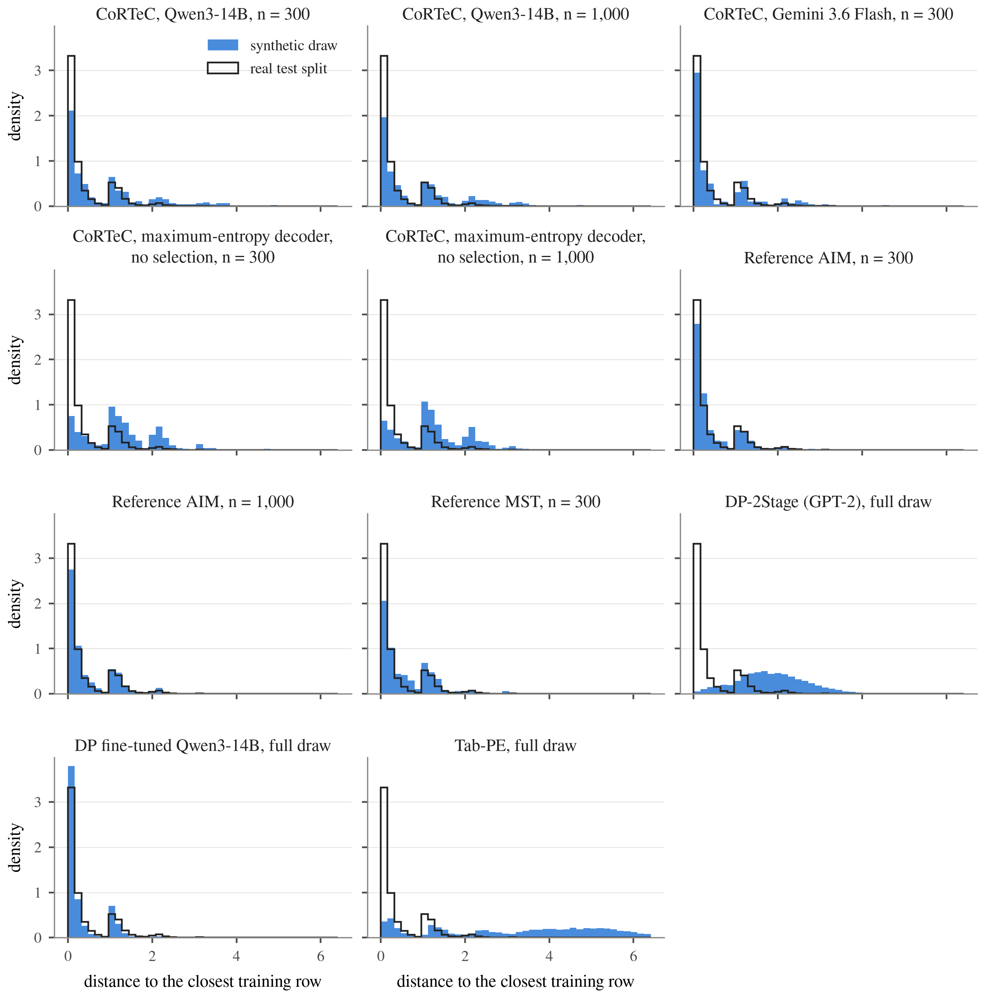

<!-- math: on -->
# CoRTeC: A Differentially Private Release for Synthetic Tabular Data, Decodable With or Without a Language Model

<div class="authors">
<p><b>Calister Nnona</b></p>
<p>calisternnona@gmail.com</p>
<p>DOI: <a href="https://doi.org/10.5281/zenodo.22945315">10.5281/zenodo.22945315</a></p>
</div>

<div class="abstract">
<p><b>Abstract.</b> Differentially private synthetic tabular data is made today by marginal mechanisms, which choose their workload on the private rows and ship a fitted model, or by language models fine-tuned or driven under the budget, which weld the model to the mechanism that spends it, so that what the model contributes cannot be measured. CoRTeC fixes the workload before the data is seen and spends the budget once, on a release built for a downstream classifier: class-conditional histograms and a conditional outcome table inside publicly defined cohorts, shipped as an auditable artefact of counts. Every decoder is post-processing: Private-PGM at no cost, or a frozen language model under exact per-bin counts and a selection step, never seeing a private record. We measure what each part contributes with four controls: the release decoded with no language model, alone and with the selection step; the schema with every name replaced by a neutral token; one-shot rows written from the column names with no release; and the reference implementations of AIM and MST, beside three recent methods under their own protocols. The release carries the fidelity and the utility: decoded with no model it matches the language-model arms, and auto-configured it is level with or ahead of the reference AIM on utility over three splits, ahead on single columns and behind on pairs at the larger size. The language model adds plausibility driven by the column names: it repairs the pairs it recognises, invents those it expects, loses its edge when the names are neutral, and without the release recites the public file. What survives every control is the privacy architecture: one release serves unlimited draws, the backbone can be replaced at no privacy cost, the strongest membership attack reaches a small fraction of the permitted advantage, and no synthetic row copies a training row.</p>
</div>

## 1. Introduction

An institution that holds sensitive tabular data wants to train models outside its own perimeter, hand realistic samples to partners and let researchers work on the problem without working on the people. Differentially private synthetic data [14, 15] is the accepted way to do all three. Two families of methods compete for the task. Marginal methods such as MST [27] and AIM [28] measure low-order marginals under the budget and fit a graphical model to them; a recent benchmark finds them the utility leaders on five datasets [10]. Methods built on language models fine-tune a pretrained model on the private rows under DP-SGD [1, 3, 38] or drive a model through its inference interface by privately scoring its candidates [24, 43]; Tab-PE keeps that private vote and replaces the model with variation operators [39]. The benchmark excludes the language-model family on purpose, because a model pretrained on public corpora may already know the public benchmarks it is evaluated on [10]; Swanberg et al. find that one-shot records from a strong model, treated as public data, help no more than uniform data on the marginal workloads of Adult [37].

Neither family fixes its workload before the data is seen. The marginal methods choose their marginals adaptively on the private rows and ship a fitted model whose structure is that choice, so a change of workload is a new run on the private rows; the fine-tuning methods put the private rows on the training hardware and spend the budget on every gradient step, so a change of model is a new training run; the inference-interface methods spend budget on every round of candidates. In none of them can the budget be spent once on counts chosen in advance and those counts decoded again, by another team, on another model, at no further cost. And in none of them can what the language model contributes beyond the private statistics be measured, because the model is welded to the mechanism that spends the budget: a fine-tuned model cannot be separated from the DP-SGD run that produced it, and a model driven through its interface spends the budget on its own rounds.

CoRTeC's contribution is a release built for a downstream classifier, decodable by any means. It spends the budget once, on that release: it groups the rows into cohorts by a public rule and, for each cohort, publishes with Laplace noise the cohort's size, its class balance, one histogram per attribute for each outcome class, and a table of outcome rates over cells that do not overlap. A frozen language model then reads that release, and nothing else, and writes rows that carry exactly the per-bin counts it is asked for; a pool of such rows is raked and refined to the released cells; values below bin resolution are redrawn inside their released bins. Generation is post-processing: it spends no budget, can be repeated without limit and can run on any model, including one reached through an interface the institution does not control; and because the model is a swappable, budget-free component, the same release can be decoded by a frozen model, by a model that knows nothing of the column names, or by no model at all, which is what lets this paper measure what the model adds.

This paper measures what that design contributes, with the controls that the field's objection to language-model methods requires. The first control decodes the same release with a maximum-entropy model and no language model. The second renames every column, category and label of the schema so that the model's knowledge of Adult cannot act. The third is the reference implementation of AIM and MST on the same split and the same public bins, fitted with a stable inference oracle and a consistency check, and sampled with the corrected sampler. The fourth is the comparison with DP-2Stage [3], DP-LLMTGen [38] and Tab-PE [39] under each paper's own protocol. Two further controls complete the square over the release and the model: the decoder's own pool passed through the selection step, and one-shot rows written from the column names with no release. Every comparison reports fidelity and utility in the same table, against a real sample of the same size, a no-information floor and a train-on-real ceiling, and the central cells are replicated on three splits with three fresh releases.

**Findings.** The release carries the result: decoded with no language model it is level with CoRTeC on single columns at every seed on both datasets and on utility on Adult, ahead of it on NHANES, and as close to the private table as a real sample on single columns on a third dataset (Section 6). Against the reference AIM the fixed-rule release trades pairs for the conditionals it budgets for, and the auto-configured release, decoded with no model and the selection step, is level with or ahead of AIM on utility at both sizes over three splits, ahead on single columns and behind on pairs at the larger size. The language model's contribution is label-driven plausibility: it repairs the logical pairs it recognises, invents dependences between near-independent columns, loses its edge on pairs and utility under neutral names, and with no release recites the public file into most of its output; the single-column edge that survives neutral names comes from the selection step, and a model-free pool gets it as well. The DP fine-tuning family and Tab-PE are behind on fidelity at the same budgets.

What survives every control is the privacy architecture. No private row reaches the model; one release serves unlimited draws; the backbone can be replaced at no privacy cost, and a ladder of four backbones shows capability improving formatting reliability and single-column fidelity and nothing else; the strongest membership attack on any arm reaches a small fraction of the advantage the budget permits; no synthetic row in any arm is a copy of a training row; and although the served Gemini backbone reproduces the head of the Adult file verbatim when prompted with its header, no memorised row appears in any draw.

**Contributions.**

- A control that separates the release from the model: a maximum-entropy decoder of CoRTeC's own release, which shows that the release is a competitive differentially private synthesiser by itself, level with or ahead of the reference AIM on utility once auto-configured, and gives every language-model number in the paper its reference point.
- A schema-anonymisation control that shows which part of a language model's contribution is knowledge of the column names, in the form DP-LLMTGen's feature-name experiment used from the other side [38].
- A comparison against the reference AIM and MST and against DP-2Stage, DP-LLMTGen and Tab-PE on one split and under their own protocols, with fidelity and utility in the same table, floors and ceiling in every table, and replication over three splits and three releases.
- The mechanism itself, with its privacy analysis as five composition steps, the selection step (a post-processing operator that takes any decoder's pool to the released cells and accounts for most of the model-free margin), two reference implementations, and the measurements a deployment needs: membership inference validated on a positive control, distance to closest record, a memorisation test of the served backbone, and the cost per thousand rows.

A companion [deployment guide](https://github.com/Calyie/cortec/blob/main/paper/CoRTeC.pdf) carries the operational material: the reference architecture, the guardrails, the failure modes met while building the method and the test that carries each one's name.

## 2. Related Work

**Marginal methods.** PrivBayes [46], MST [27], PrivMRF [7] and AIM [28] select low-order marginals under the budget and fit a graphical model with Private-PGM [26]. MST won the 2018 NIST challenge, whose entries Bowen and Snoke compare on marginal, joint and correlation measures [6]; AIM selects marginals adaptively and is the strongest of the family. The benchmark of Chen et al. [10] finds AIM and PrivMRF the utility leaders over five datasets and three budgets, with machine-learning efficacy, 3-way query error and 2-way total variation as its measures; the earlier benchmark of Tao et al. [36] reached the same ordering against the generative methods of its day. Our reference AIM and MST rows are the authors' private-pgm implementation on our public bins.

**Generators trained under differential privacy.** DP-GAN [44] and DP-CTGAN [32] train a generative adversarial network, CTGAN [42] in the latter case, under DP-SGD [1]; PATE-GAN [22] trains it under PATE [30, 31]; DP-TBART [8] trains an autoregressive transformer under DP-SGD and reaches the marginal methods' level on most of its datasets; DP-TLDM [47] trains a latent diffusion model the same way. The evaluations above find the adversarial and diffusion generators behind the marginal methods on tabular data, and we carry them as citations rather than as rows.

**Language models fine-tuned on the private rows.** GReaT [5] serialises each row as "column is value" text and fine-tunes GPT-2 with no privacy guarantee. DP-LLMTGen [38] fine-tunes Llama-2 7B in two stages, format learning on random tables and DP-SGD on the private rows with a loss that weights the value tokens, and finds that meaningful feature names help the fine-tuned model. DP-2Stage [3] fine-tunes GPT-2 the same way, with a pseudo-data stage first, and reports AIM ahead of it on Adult. In each the private rows reach the training hardware and the budget is spent on per-sample gradients over every epoch.

**Methods that keep the model frozen.** Private Evolution [24] and its text version [43] generate candidates from a foundation model, let the private records vote for their nearest candidates under a Gaussian mechanism, and iterate; Tab-PE [39] replaces the model with heuristic variation operators and shows that marginal methods cannot carry high-order correlations that the standard benchmarks do not test. Swanberg et al. [37] adapt Private Evolution to tabular data and also try one-shot generation from column names alone, used as public data inside a marginal mechanism; neither beats the marginal baselines on Adult, and their one-shot rows carry 1-way marginals but not pairs. Private Evolution with a foundation model in the loop is therefore the published negative result on tabular data [37]; its tabular successor, which replaces the model with variation operators [39], is run here, as is the one-shot arm, and we do not contest the earlier finding. CoRTeC differs from both in what the model is given: a differentially private release of conditional statistics, which the selection step then enforces. Two hybrids lie between the families: Swanberg et al. place language-model rows as public data inside a marginal mechanism [37], and the hybrid released with this paper relabels a marginal synthesiser's output with a differentially private conditional table (deployment guide). Table 1 states the properties.

**Table 1:** What each method needs. The budget column says where the privacy loss is incurred.

| method | model weights | private rows seen by | public or side data | budget spent on | adaptive rounds | backbone swap |
|---|---|---|---|---|---|---|
| CoRTeC | no; any inference interface | Stage A only; the model never sees a row | column names and value lists | one release of counts, composed once | none | at no privacy cost |
| AIM, MST | none | the measured marginals | public domains and bins | measured marginals; AIM selects adaptively | AIM yes | not applicable |
| DP-2Stage | GPT-2, full fine-tune | the DP-SGD trainer | pseudo data (uniform over private ranges, or a public table) | per-sample gradients, every step | yes | retrain |
| DP-LLMTGen | Llama-2 7B, LoRA | the DP-SGD trainer | random tables from names, categories and ranges | per-sample gradients, every step | yes | retrain |
| Tab-PE | none | the nearest-neighbour histogram, every iteration | numerical bounds; class counts | Gaussian noise on the histogram, 15 to 30 rounds | yes | not applicable |
| one-shot records [37] | no | none by the model; the downstream mechanism | column names and types | inside the downstream mechanism | depends | at no privacy cost |

## 3. Preliminaries and Privacy Model

A dataset $D$ is a multiset of $n$ records over attributes $A = A_{num} \cup A_{cat}$ and a binary target $y$. Each attribute has a public domain, an interval for a numerical attribute and a finite value set for a categorical one, and public bin edges partition each numerical domain. $M_a(D)$ is the histogram of attribute $a$ over its bins; for a cell $c$ of the record space, $k_c(D)$ is the number of records in $c$ with $y = 1$. Two datasets are neighbours if one is obtained from the other by adding or removing one record.

**Definition 1 (Differential privacy [14]).** *A randomised mechanism $\mathcal{M}$ is ε-differentially private if for all neighbours $D, D'$ and all sets $S$ of outputs, $\Pr[\mathcal{M}(D) \in S] \le e^{ε} \Pr[\mathcal{M}(D') \in S]$.*

The Laplace mechanism adds $\mathrm{Lap}(Δ/ε)$ noise to a function of L1 sensitivity $Δ$ and is ε-differentially private [14]. A histogram over any number of bins and a counting query both have $Δ = 1$. Mechanisms run on the same data compose sequentially, with budgets adding [15]; mechanisms run on disjoint parts of the data defined by a data-independent rule compose in parallel, at the largest of their budgets [29]; and any computation on the output of a private mechanism that does not read $D$ again is post-processing and adds nothing [15]. Definition 1 also bounds any membership adversary: no test for whether a record is in $D$ can have true-positive rate exceeding false-positive rate by more than $(e^{ε} - 1)/(e^{ε} + 1)$, which is 0.762 at ε = 2.

**Threat model.** The adversary is computationally unbounded and sees everything that crosses the trust boundary: the release $R$, every synthetic dataset drawn from it, and the model's inputs and outputs. The institution's extract, the schema declaration and the release engine run inside its perimeter and are the only code that reads $D$. The generator, the selection step and every downstream use read $R$ and their own output only. Whoever operates the model, including a hostile endpoint, learns nothing that $R$ does not reveal, and $R$ is ε-differentially private.

**Privacy model.** The guarantee is pure ε (δ = 0), central, under add/remove adjacency, and protects one row. On data with one row per person it protects a person; on encounter-level data the per-person guarantee weakens by the maximum number of rows one person contributes, and the reference implementation requires that maximum to be declared. Two quantities are treated as public, as in every marginal method: the attribute list with its domains and bins, and the stratification rule that forms the cohorts. Cohort sizes, class balances and cell supports are private counts and are released with noise, not assumed. The model's pretraining corpus is outside the guarantee: if a private record was in it, it was compromised before CoRTeC ran; we follow prior work in treating a public pretrained model as public [37, 40] and measure the one consequence that matters, whether anything memorised reaches a draw (Section 6).

## 4. The Mechanism

CoRTeC has three stages (Figure 1). Stage A is the only code that reads $D$; it produces the release $R$. Stage B decodes $R$ with a frozen language model and a selection step, reading $R$ and its own output only. Stage C, optional and separately budgeted, bounds how far the synthetic conditional rates lie from the private ones.

{: .wide}

**Figure 1:** The privacy budget is spent once, in Stage A. Everything to the right of the dashed line reads only released statistics and may be repeated without limit.

### 4.1 Stage A: the release

```algorithm
Algorithm 1: CoRTeC-Release
Input: private $D$; public schema (domains, bin edges, stratification rule $\Pi$, conditional levels $L_0 \subset \dots \subset L_k$); budget $ε_{total}$; conditional share $α$; count share $γ$; suppression floor $n_{min}$
Output: release $R$
(1) $ε_{count} \leftarrow γ ε_{total}$;  $ε_{marg} \leftarrow (1 - α)(ε_{total} - ε_{count})$;  $ε_{cond} \leftarrow α (ε_{total} - ε_{count})$
(2) $q \leftarrow |A| + 1$ queries per cohort;  $ε_q \leftarrow ε_{marg} / q$;  $ε_L \leftarrow ε_{cond} / |L|$
(3) For each cohort $P$ the rule $\Pi$ can form, holding records or not:
(4)     $\tilde{n}_P \leftarrow |P| + \mathrm{Lap}(1/ε_{count})$; if $\tilde{n}_P < n_{min}$ continue; release $\tilde{n}_P$
(5)     release the two-bin histogram of $y$ on $P$, each count $+ \mathrm{Lap}(1/ε_q)$
(6)     if both noised class counts are at least $n_{min}$: for $c \in \{0, 1\}$ and $a \in A$ release $M_a(P \cap \{y = c\}) + \mathrm{Lap}(1/ε_q)$
(7)     else: for $a \in A$ release $M_a(P) + \mathrm{Lap}(1/ε_q)$  (pooled block)
(8) For each level $\ell \in L$ and each cell $c$ of its public domain, holding records or not:
(9)     $\tilde{k}_c \leftarrow k_c(D) + \mathrm{Lap}(2/ε_L)$;  $\tilde{n}_c \leftarrow |c| + \mathrm{Lap}(2/ε_L)$;  if $\tilde{n}_c < n_{min}$ continue
(10)    release $\tilde{ρ}_c \leftarrow \mathrm{clip}(\tilde{k}_c / \max(\tilde{n}_c, n_{min}), 0, 1)$
(11) Return $R$ with every released quantity, its ε, sensitivity and composition rule
```

Four decisions make the release cheap. Cohorts come from a rule over public domains, so forming them costs nothing, and the cohorts are disjoint, so their queries compose in parallel. Histograms replace moments: a histogram has sensitivity 1 at any resolution, so an entire distributional shape costs what one count costs. One histogram block per outcome class costs what a pooled block costs, because the two class blocks are disjoint; the pooled histogram is their mixture under the released class balance, which is post-processing, and a cohort whose minority class falls below $n_{min}$ keeps the pooled block. The conditional table is released over the cells of a partition, so each level receives the full $ε_L$ however many cells it holds; a cell's rate is the ratio of two counts noised at a public scale, which keeps the mechanism pure ε, where noising the rate directly at a scale set by the private cell size would not. Every $n_{min}$ decision compares a noised, charged count with the public floor, so which cohorts and cells appear in $R$ is a function of released quantities. An auto-configurator derives $\Pi$ and $L$ from the schema, the budget and the requested size, and charges the one step that reads $D$, a noised contingency table per candidate column (Appendix D).

### 4.2 Stage B: exact counts, selection and the sub-bin rule

Stage B allocates rows to cohorts in proportion to released size, apportions exact per-bin, per-category and per-class counts from the released histograms, and asks the frozen model for batches of 25 rows that carry the counts the cohort still owes. The prompt (Appendix D) carries the release and the counts and never a record; it states the counts per outcome class, and it instructs the model to follow the released statistics even where they contradict its expectations. Rows that parse, lie inside their domains and carry declared categories enter a pool $k$ times larger than the requested size, with $k$ = 3 on Adult and bank and 2 on NHANES. Generation is per cohort, not per released cell: a cell-wise variant emitted nothing for the population the released cells did not name and dropped whole subgroups while every aggregate check passed, a disparate impact of the kind Ganev et al. document for differentially private synthesis [17], and the reference implementation refuses that path below a coverage floor (deployment guide).

```algorithm
Algorithm 2: CoRTeC-Select
Input: release $R$; pool $\hat{D}$; requested size $m$
Output: synthetic dataset $\hat{D}^*$ of $m$ rows
(1) Require that every cohort $P$ holds at least $1.1 m \tilde{n}_P / Σ \tilde{n}$ pool rows (coverage guard)
(2) $w \leftarrow$ inclusion weights by iterative proportional fitting [12] of $\hat{D}$ to every released cell: cohort sizes, class balances and every histogram; a suppressed category receives weight 0
(3) $\hat{D}^* \leftarrow$ a systematic sample of $m$ rows under $w$  (rake)
(4) Swap a row of $\hat{D}^*$ for a pool row whenever the swap lowers the weighted L1 distance between the cell counts of $\hat{D}^*$ and $R$, until no swap improves it  (refine)
(5) In every cohort with class blocks, redraw each numerical value uniformly inside its released bin intersected with its stratification band; integer columns draw integers  (sub-bin rule)
(6) Return $\hat{D}^*$
```

Exact counts make the pool match the release closely; selection removes the sampling error that any $m$ rows drawn from a faithful pool carry; the sub-bin rule makes the structure below bin resolution the release's rather than the model's, since a released histogram fixes bin counts and nothing finer. Each step reads $R$, the generated rows and independent randomness, and nothing else. Whether a numerical column is integer-valued is decided from the public bin edges and bounds together with the majority of the pool's values; a version that decided it from every value let one model-written "45.0" turn a whole column into real-valued redraws, and every draw in this paper is scored after that correction (Appendix D).

**The maximum-entropy decoder.** To measure what the language model contributes, the same release is decoded with no model: the maximum-entropy distribution consistent with every released cell, fitted by Private-PGM [26] to exactly the numbers in $R$ and sampled at the same $n$. It spends no budget, because it reads $R$ only, and it is the control every language-model row in Section 6 is read against. Seen from the marginal methods' side, the release is a fixed workload, class-conditional 1-way marginals inside cohorts and the conditional cells, chosen before the data is seen, and the decoder is that workload fitted by the estimator AIM itself uses; what separates CoRTeC's release from AIM is the workload, not the inference engine. AIM's adaptive selection gives the pairs (Section 6); the fixed workload gives the conditionals the deployment names, an artefact a reader can inspect cell by cell, and a release that takes seconds.

**Stage C.** For each released cell the private data has a positive rate $p_c$ and the synthetic data a public rate $q_c$. Stage C releases a Laplace estimate of $p_c$ over the public floor at a declared budget $ε_{cert}$, turns it into a simultaneous bound on $|p_c - q_c|$ over all cells, and refuses a verdict unless a real hold-out sample clears the tolerance and a permuted one fails it, and unless every cell holds at least 20 synthetic rows. The bound speaks to utility only (Appendix E.5).

### 4.3 Privacy analysis

**Theorem 1.** *Algorithms 1 and 2 together with the generation step are $ε_{total}$-differentially private; with auto-configuration the total is $ε_{sel} + ε_{release} = ε_{total}$; Stage C adds $ε_{cert}$.*

The proof (Appendix A) is five steps of composition. (i) Stratification reads public domains only and is free. (ii) Within a cohort, the class-balance query and the $|A|$ histograms of one record's own class block are a chain of $q$ Laplace queries of sensitivity 1, composing sequentially to $ε_{marg}$; the two class blocks are disjoint and compose in parallel. (iii) Across cohorts, the queries compose in parallel, because a record lies in exactly one cohort. (iv) Within a conditional level, the cells partition $D$ and compose in parallel; a cell's two counts compose sequentially to $ε_L$, and the published rate is post-processing of two released counts and the public floor. (v) Across levels, which describe the same individuals, the budgets add to $ε_{cond}$; the cohort sizes cost $ε_{count}$ in parallel across cohorts. Generation, selection and the sub-bin rule read $R$, the generated rows and randomness, so by post-processing they add nothing at any pool factor and for any number of draws. Summing, $ε_{count} + ε_{marg} + ε_{cond} = ε_{total}$.

## 5. Experimental Setup

**Table 2:** Datasets. Every split is seed 42; the replication seeds 43 and 44 draw a fresh split and a fresh release each.

| dataset | records | train / test | numerical / categorical | target, positive rate | role |
|---|---|---|---|---|---|
| UCI Adult [13, 23] | 32,561 | 26,048 / 6,513 | 6 / 8 | income over 50K, 24.1 % | every comparison, the controls, the ladder, the replication |
| NHANES 2017-2018 [9] | 3,749 adults | 2,999 / 750 | 5 / 4 | HbA1c at or above 6.5 %, 14.2 % | auto-configured clinical dataset, the replication |
| bank marketing [25] | 45,211 | 36,168 / 9,043 | 5 / 8 | term deposit, 11.7 % | third dataset, one split |

**Baselines.** The reference AIM and MST are the authors' private-pgm implementation (mbi 1.1) fitted on the training split under the same public bins CoRTeC declares, at the same ε, with the message-passing oracle set to its stable variant, whose empirical privacy Ganev et al. audit as close to the stated guarantee [16], and a consistency check between the fitted marginals and the noisy measurements, because the library's default oracle produced empty or near-uniform fits on two of our three splits; every reported fit passed the check at its first attempt, and the seed-42 fits under the default oracle reproduce to the third decimal (Appendix D). Their sampler is the corrected one (Appendix D). An earlier version of this work (Zenodo record 23258254) compared against the smartnoise-synth implementations of AIM and MST at their library defaults, which carry the sampler defect of Appendix D and whose students score 0.15 to 0.17 AUC below the reference implementation's on Adult at $n$ = 300; every AIM and MST number here is the authors' private-pgm. DP-2Stage runs the authors' code (GPT-2, DP-SGD, δ = 10⁻⁵) on our split. The DP fine-tuning rows apply DP-LLMTGen's two-stage LoRA [20] procedure and loss to Qwen3-14B, Qwen2.5-7B and Llama-2 7B on our split (δ = 10⁻⁵), so that the same backbone appears under two privacy architectures. Tab-PE runs the authors' code with a 1,000-row population (600 on NHANES), δ = 1/(n ln n); its own evaluator, TabICL [19], scores the Tab-PE protocol rows. The maximum-entropy decoder is defined in Section 4.2. Two controls complete a two-by-two over the release and the model: the release with no model (the decoder, alone and with the selection step of Algorithm 2 applied to its pool), the release with a model (CoRTeC), the model with no release (one-shot rows from the column names alone, the baseline Swanberg et al. use [37]) and, for neither, the permuted-target floor.

**CoRTeC configuration.** One set of flags, fixed before the campaign: ε = 2 with α = 0.2, γ = 0.02 and $n_{min}$ = 150; batches of 25 rows; the counts stated per outcome class; a pool factor of 3 (2 on NHANES); selection with the sub-bin rule; cohorts and conditional levels from the auto-configurator for NHANES and bank and the schema's own rule for Adult. The auto-configurator is the shipped default and was used on NHANES and bank; Adult was the one dataset still on a hand-written rule, so after the campaign the default was run there too, which closes an inconsistency rather than opening a search: the released implementation's Stage A derives the cohorts and the hierarchy on each split, charging the selection to the same budget, at the implementation's count share of 0.05 plus the gate charge against the campaign's 0.02 (the designs are in Appendix D). That release is decoded with no model and the selection step only, and it is labelled "auto-configured, no model, with selection" wherever it appears. The backbones are Qwen3-8B, Qwen3-14B and Qwen3-32B (4-bit AWQ), served locally through vLLM, and Gemini 3.6 Flash through Google's interface, which has served the Gemini 3.5 Flash identifier since 8 October 2026. The Qwen3-14B arm is the primary arm; a Qwen2.5-7B arm appears where a protocol was run on it only (Table 4, Appendix E.6).

**Why ε = 2.** The recent papers report ε = 1 as their headline (DP-2Stage, Tab-PE) with ε = 0.5 and 8 in appendices (DP-LLMTGen, DP-2Stage), and the benchmark uses 0.2, 1 and 5. We keep ε = 2 as the headline for the comparison of architectures on one split, for a reason that follows from the release: at the shipped split each count of a conditional cell is noised at scale 10.2, so a cell at the suppression floor of 150 records carries its rate to within about 0.1, and at ε = 1 and 0.5 that becomes about 0.2 and 0.4, where the conditional table stops being informative near the floor and the comparison would measure the noise rather than the architectures. Every method also appears at a budget its own paper uses: the reference AIM, MST and the CoRTeC release at ε = 0.5 and 1 under the DP-LLMTGen protocol and at ε = 1 under the DP-2Stage and Tab-PE protocols (Table 4 and Appendix E.6), and the release's own decoder at ε = 0.5 and 1 on our protocol (Appendix E.6). At ε = 1 the release and its decoder are level with DP-LLMTGen and Tab-PE on their own utility measures, ahead of DP-2Stage, and behind the reference AIM on fidelity, so the headline budget does not hide a worse trade-off at the budgets those papers prefer.

**Metrics.** Fidelity: 1-way and 2-way total variation between the synthetic table and the full private training table, over the public bins; conditional total variation of $P(y \mid \text{group})$ over the cohort bands the release describes ("seen") and over group families sharing no column with the conditioning ("held-out"). Utility: train-on-synthetic, test-on-real AUC [32] under logistic regression, a random forest and gradient boosting, on the real test split. Definitions are in Appendix B. Each paper protocol in Table 3 uses that paper's own metrics and split.

**Floors, ceiling and repetition.** Every table carries three references at the same $n$: a real sample of $n$ training rows (no synthetic method can be expected to beat it), the same rows with the target permuted (a no-information floor), and students trained on a real sample of 4,000 training rows (the ceiling; the whole split on NHANES, which holds 2,999). Any metric that fails to separate the first two has no power, and we checked that before reading any table; evaluating against explicit reference points rather than a bare threshold is the discipline DPBench argues for [18]. Every cell is the mean over three draws with the sample standard deviation; the central cells are replicated on seeds 43 and 44 with fresh splits and releases, and paired differences across seeds are reported with their sign count and a paired t-test. Single-split and single-draw cells are labelled as such and are read as signals.

## 6. Results

**Table 3:** Adult at ε = 2 on the seed-42 split, three draws per arm. Fidelity and utility in one table; lower is better on the first four columns, higher on the last three. The membership column is the strongest advantage of four attacks on 3,000 candidates (Appendix F); the permitted advantage is 0.762. The Gemini arm was run at $n$ = 300 only. The decoder-with-selection row is the same release decoded with no model and then passed through Algorithm 2 on a pool of three times $n$, as every CoRTeC arm is; the one-shot row is the same Gemini backbone writing rows from the column names alone, with no release and no private data, of which about 70 % are verbatim copies of the public file's first 25 rows (Appendix F.3). The auto-configured row is the release the auto-configurator derives on Adult (Section 5), decoded with no model and the selection step; its conditional cells are not comparable (n/a): the evaluator's seen bands are the fixed rule's cohorts, which that release does not condition on, and two of the three held-out families are columns it conditions on (Appendix E.2 gives the clean family).

| condition, $n$ = 300 | 1-way TV | 2-way TV | cond. seen | cond. held-out | TSTR-LR | TSTR-RF | TSTR-GBM | MIA adv. |
|---|---|---|---|---|---|---|---|---|
| *real sample of 4,000 rows (utility ceiling)* | *0.011* | *0.028* | *0.020* | *0.008* | *0.860* | *0.907* | *0.914* | |
| *real sample (floor)* | *0.043* | *0.107* | *0.062* | *0.036* | *0.830* | *0.870* | *0.840* | |
| *permuted target (no information)* | *0.041* | *0.110* | *0.152* | *0.102* | *0.423* | *0.485* | *0.482* | |
| CoRTeC, Qwen3-14B | 0.046 | 0.139 | 0.027 | 0.048 | 0.807 | 0.862 | 0.833 | 0.022 |
| CoRTeC, Gemini 3.6 Flash | 0.027 | 0.110 | 0.013 | 0.042 | 0.805 | 0.863 | 0.838 | 0.022 |
| maximum-entropy decoder of the release | 0.058 | 0.146 | 0.082 | 0.049 | 0.818 | 0.856 | 0.847 | 0.025 |
| maximum-entropy decoder with the selection step | 0.033 | 0.118 | 0.014 | 0.048 | 0.824 | 0.866 | 0.862 | 0.024 |
| auto-configured release, no model, with selection | 0.019 | 0.108 | n/a | n/a | 0.826 | 0.873 | 0.860 | 0.025 |
| reference AIM | 0.056 | 0.122 | 0.055 | 0.047 | 0.845 | 0.869 | 0.845 | 0.024 |
| reference MST | 0.048 | 0.121 | 0.140 | 0.043 | 0.733 | 0.802 | 0.748 | 0.032 |
| DP-2Stage, GPT-2 | 0.280 | 0.465 | 0.147 | 0.141 | 0.598 | 0.607 | 0.601 | 0.021 |
| DP fine-tuned Qwen3-14B | 0.106 | 0.190 | 0.087 | 0.071 | 0.809 | 0.832 | 0.815 | 0.024 |
| Tab-PE | 0.203 | 0.366 | 0.134 | 0.049 | 0.812 | 0.856 | 0.839 | not run |
| one-shot from the column names, Gemini 3.6 Flash (no release) | 0.148 | 0.307 | 0.214 | 0.136 | 0.795 | 0.850 | 0.831 | 0.012 |
| **condition, $n$ = 1,000** | | | | | | | | |
| *real sample (floor)* | *0.026* | *0.061* | *0.031* | *0.019* | *0.855* | *0.892* | *0.883* | |
| *permuted target (no information)* | *0.025* | *0.069* | *0.146* | *0.095* | *0.511* | *0.508* | *0.513* | |
| CoRTeC, Qwen3-14B | 0.036 | 0.108 | 0.022 | 0.031 | 0.827 | 0.860 | 0.859 | |
| maximum-entropy decoder of the release | 0.041 | 0.106 | 0.034 | 0.045 | 0.826 | 0.870 | 0.863 | |
| maximum-entropy decoder with the selection step | 0.027 | 0.089 | 0.008 | 0.037 | 0.836 | 0.873 | 0.874 | |
| auto-configured release, no model, with selection | 0.016 | 0.081 | n/a | n/a | 0.841 | 0.884 | 0.884 | |
| reference AIM | 0.029 | 0.072 | 0.028 | 0.030 | 0.854 | 0.888 | 0.883 | |
| reference MST | 0.031 | 0.083 | 0.132 | 0.044 | 0.788 | 0.818 | 0.804 | |
| DP-2Stage, GPT-2 | 0.277 | 0.454 | 0.138 | 0.133 | 0.527 | 0.485 | 0.484 | |
| DP fine-tuned Qwen3-14B | 0.100 | 0.172 | 0.050 | 0.054 | 0.809 | 0.845 | 0.836 | |
| Tab-PE | 0.196 | 0.350 | 0.101 | 0.031 | 0.819 | 0.854 | 0.843 | |
| one-shot from the column names, Gemini 3.6 Flash (no release) | 0.146 | 0.305 | 0.191 | 0.137 | 0.807 | 0.860 | 0.844 | |

**Table 4:** The three papers' own protocols on Adult, ε = 1, one split. The published rows are the papers'; our rows are scored by our implementation of each paper's metric set. Under the DP-LLMTGen protocol the distance columns are on our scorer's scale, which reads the training set itself at 0.009 against the paper's 0.004, so only the utility columns are comparable across the two sources; under the Tab-PE protocol the embedding-space precision and recall are implementation-dependent and are left to Appendix E. Rows marked three seeds are means over the three Tab-PE splits.

| protocol and method | fidelity (paper's measure) | utility (paper's measure) |
|---|---|---|
| **DP-LLMTGen protocol** (1-way, 2-way TVD against the test split; XGBoost ACC, AUC) | | |
| DP-LLMTGen, Llama-2 7B (published) | 0.038, 0.068 | 0.831, 0.879 |
| RAP++ (published) | 0.054, 0.099 | 0.803, 0.807 |
| CoRTeC, Qwen2.5-7B (ours) | 0.060, 0.121 | 0.831, 0.881 |
| maximum-entropy decoder (ours) | 0.034, 0.089 | 0.818, 0.888 |
| reference AIM (ours) | 0.018, 0.046 | 0.850, 0.902 |
| reference MST (ours) | 0.018, 0.061 | 0.813, 0.836 |
| DP fine-tuned Llama-2 7B, our run of the procedure | 0.103, 0.177 | 0.795, 0.841 |
| **DP-2Stage protocol** (their split and metric suite; Pair, HIST, CorAcc in %; F1, AUC in %) | | |
| real data (published) | 97.5, 99.1, 97.3 | 69.9, 91.7 |
| AIM (published) | 77.1, 88.4, 86.4 | 59.6, 86.8 |
| DP-2Stage-O (published) | 72.3, 88.5, 55.4 | 30.4, 61.6 |
| DP-2Stage-O, our run of their code | 63.0, 84.7, 56.4 | 26.2, 59.9 |
| CoRTeC, Qwen2.5-7B (ours) | 70.8, 84.6, 63.6 | 61.8, 87.1 |
| maximum-entropy decoder (ours) | 74.3, 87.6, 69.8 | 62.8, 87.1 |
| reference AIM (ours) | 93.1, 97.2, 83.1 | 62.9, 87.7 |
| reference MST (ours) | 92.6, 97.2, 74.2 | 51.5, 84.0 |
| **Tab-PE protocol** (1-WD, 2-WD against the private table; TabICL accuracy, macro F1) | | |
| real data (published UB) | 0.014, 0.027 | 84.41, 75.68 |
| AIM (published) | 0.017, 0.034 | 83.36, 76.10 |
| Tab-PE (published) | 0.049, 0.086 | 82.22, 73.66 |
| Tab-PE, our run of their code, three seeds | 0.044, 0.093 | 82.19, 72.96 |
| CoRTeC, Qwen3-14B, three seeds | 0.040, 0.100 | 81.44, 74.46 |
| CoRTeC, Qwen3-32B, three seeds | 0.039, 0.101 | 81.42, 74.98 |
| CoRTeC, Qwen2.5-7B, three seeds | 0.088, 0.176 | 81.75, 74.10 |
| maximum-entropy decoder, three seeds | 0.045, 0.109 | 81.97, 76.55 |
| reference AIM, three seeds | 0.022, 0.061 | 81.69, 70.84 |
| reference MST, three seeds | 0.023, 0.062 | 80.86, 64.68 |

**RQ1. Does the release carry the result? Yes: decoded with no language model, the release matches CoRTeC on single columns and on utility at every seed.** On Adult at $n$ = 1,000 the maximum-entropy decoder reads 0.041 on single columns, 0.106 on pairs and 0.826, 0.870 and 0.863 on the three students, against CoRTeC's 0.036, 0.108 and 0.827, 0.860, 0.859 (Table 3); over seeds 42, 43 and 44 the paired differences are within 0.005 on every fidelity measure and within 0.005 AUC on every student, with no consistent sign (Table 6). At $n$ = 300 the decoder's seen-conditional error is worse (0.073 against 0.035 over seeds, 0 of 3 seeds in the decoder's favour, p = 0.04) and its gradient-boosting student better by 0.012 (3 of 3, p = 0.01). On NHANES the decoder is ahead of CoRTeC on pairs at every seed (0.117 against 0.161 at $n$ = 300, 0.087 against 0.151 at $n$ = 1,000) and on every student at $n$ = 1,000 (0.769, 0.745, 0.722 against 0.732, 0.686, 0.669; 3 of 3 seeds each, p = 0.06 to 0.10). On bank marketing, one split, the decoder is at the real sample's floor on single columns (0.026 and 0.013 at the two sizes against 0.025 and 0.014) and level with the reference AIM on pairs and utility (Appendix E). Under the three paper protocols the decoder is within 0.01 of CoRTeC on every utility measure and ahead of the Qwen2.5-7B arm on every fidelity measure (Table 4). The release is a competitive differentially private synthesiser on its own, and it is the reference point for everything the model adds. Passing the decoder's own pool through the selection step of Algorithm 2, as every CoRTeC arm is, closes the one gap, and the result replicates: over the three splits the decoder with selection reads 0.035, 0.120 and 0.017 at $n$ = 300 and 0.027, 0.090 and 0.007 at $n$ = 1,000 (0 of 3 seeds in the plain decoder's favour on every fidelity measure, p ≤ 0.03 except the held-out conditional at $n$ = 300, p = 0.20), below a real sample on single columns at $n$ = 300 (0.035 against 0.044) and near it at $n$ = 1,000 (0.027 against 0.024), below it on the seen conditionals at both sizes (0.017 and 0.007 against 0.066 and 0.035), with students within 0.014 of the reference AIM's, behind on the forest at both sizes and on the linear student at $n$ = 1,000 (0 of 3, p = 0.01, 0.06 and 0.02) and ahead on gradient boosting at $n$ = 300 (3 of 3, p = 0.01; Table 6, Appendix E.2). The release the auto-configurator derives on Adult, decoded the same way, goes further and replicates: over the three splits it is ahead of the reference AIM on single columns (0.020 against 0.052 at $n$ = 300 and 0.016 against 0.031 at $n$ = 1,000; 0 of 3 seeds in AIM's favour, p ≤ 0.01) and on pairs at $n$ = 300 (0.109 against 0.120, 0 of 3, p = 0.05), level with or ahead of it on the students (within 0.007 AUC at $n$ = 1,000 with no consistent sign; the gradient-boosting student ahead by 0.020 at $n$ = 300, 3 of 3, p = 0.03), and behind it on pairs at $n$ = 1,000 (0.082 against 0.074, 3 of 3, p < 0.01; Table 6, Appendix E.2). Its conditional cells are not compared, because the evaluator's seen bands are the fixed rule's cohorts and two of the three held-out families are columns that release conditions on; over the one clean family it is ahead of AIM at both sizes (Appendix E.2). The attribution is in the same table: of its single-column margin over the plain decoder, 0.038 at $n$ = 300 and 0.025 at $n$ = 1,000, the selection step accounts for 0.023 and 0.014 and the auto-configured workload for 0.015 and 0.011, each step at 0 of 3 seeds against (p ≤ 0.03); on the students each step adds 0.003 to 0.009, significant only for the selection step on the forest at $n$ = 1,000 (p = 0.01; the linear student p = 0.05).

**RQ2. What does the language model add? Plausibility driven by the column names.** The aggregate effect of the model over the decoder is neutral on Adult, negative on NHANES pairs at every seed (p ≤ 0.02 at both sizes) and negative on bank at both sizes (single columns 0.040 against 0.026, pairs 0.112 against 0.066 at $n$ = 300). Its one consistent gain over the plain decoder is on the conditionals the release names: on Adult the seen-conditional error is lower at 3 of 3 seeds at $n$ = 300 (0.035 against 0.073, p = 0.04) and lower by 0.005 at $n$ = 1,000, a difference that does not replicate (1 of 3 seeds, p = 0.38). That gain is the selection step's and not the model's: the decoder's own pool passed through Algorithm 2 reads 0.017 at $n$ = 300 and 0.007 at $n$ = 1,000 over three seeds (0 of 3 in the plain decoder's favour, p ≤ 0.01; Table 6), below both. Without the release, the same Gemini backbone writing rows from the column names alone reads 0.148 on single columns, 0.307 on pairs and 0.214 on the seen conditionals, worse than the permuted floor on the conditionals, and about 70 % of its rows are verbatim copies of the public file's first 25 rows (Appendix F.3); its students still reach 0.795, 0.850 and 0.831, within 0.025 AUC of the CoRTeC arms and the decoder on every student. That is Swanberg et al.'s finding [37] in its strongest form: on a public benchmark the utility columns separate the arms weakly and the fidelity columns carry the comparison; with the release, the same backbone copies none of those rows into any draw. Per pair, the model's error against the private table is below the decoder's on the pairs it recognises as logical, education with education number, marital status with relationship, relationship with sex on Adult, days since contact with the previous outcome on bank, and above it on pairs it believes related and the data does not: education with contact, contact with the previous outcome, marital status with education, loan with contact on bank (Appendix E.3). The model repairs what it knows and invents what it expects.

**RQ3. Does the edge survive neutral names? No for pairs and utility; yes for single columns, and that part is the selection step.** The anonymised schema renames every column, category and label to neutral tokens, maps the release and the prompt accordingly and de-anonymises the draws before scoring, so the model sees the same numbers with no meaning attached (Appendix C). Table 5 gives the result on Adult at $n$ = 300. On Gemini 3.6 Flash the pair error rises from 0.110 to 0.148, the decoder's level (0.146), and the students fall from 0.805, 0.863, 0.838 to 0.745, 0.840, 0.798, below the decoder's 0.818, 0.856, 0.847; the single-column error stays at 0.030 against the decoder's 0.058, which is the selection step raking the pool to the released marginals, not the names. On Qwen3-14B every measure is worse without names (single columns 0.065, pairs 0.168, students 0.811, 0.846, 0.817), and on Qwen3-32B the same at two draws. DP-LLMTGen found that meaningful names help a fine-tuned model [38]; this is the same mechanism read from the other side, in a design where the model is frozen and the names are the only channel its knowledge has. The decoder-with-selection row of Table 3 says the same directly: the selection step on a model-free pool reaches 0.033 on single columns and 0.014 on the seen conditionals, within 0.006 of the Gemini arm's 0.027 and 0.013, with no names in play.

**Table 5:** The anonymised-schema control, Adult, ε = 2, $n$ = 300, the same releases under neutral names. Two draws for the 32B arm; the others three.

| backbone | names | 1-way TV | 2-way TV | cond. seen | cond. held-out | TSTR-LR | TSTR-RF | TSTR-GBM |
|---|---|---|---|---|---|---|---|---|
| Gemini 3.6 Flash | real | 0.027 | 0.110 | 0.013 | 0.042 | 0.805 | 0.863 | 0.838 |
| Gemini 3.6 Flash | neutral | 0.030 | 0.148 | 0.014 | 0.044 | 0.745 | 0.840 | 0.798 |
| Qwen3-14B | real | 0.046 | 0.139 | 0.027 | 0.048 | 0.807 | 0.862 | 0.833 |
| Qwen3-14B | neutral | 0.065 | 0.168 | 0.044 | 0.054 | 0.811 | 0.846 | 0.817 |
| Qwen3-32B (AWQ) | real | 0.049 | 0.138 | 0.031 | 0.046 | 0.815 | 0.864 | 0.840 |
| Qwen3-32B (AWQ) | neutral, 2 draws | 0.060 | 0.159 | 0.067 | 0.052 | 0.785 | 0.858 | 0.822 |
| *maximum-entropy decoder* | *none* | *0.058* | *0.146* | *0.082* | *0.049* | *0.818* | *0.856* | *0.847* |
| *real sample* | | *0.043* | *0.107* | *0.062* | *0.036* | *0.830* | *0.870* | *0.840* |

**RQ4. Does the reading replicate, and where is the reference AIM ahead? It replicates at three seeds and on a third dataset; AIM is ahead on pairs everywhere and on utility at Adult $n$ = 1,000 against the fixed-rule release, and level with or behind the auto-configured release on utility.** Table 6 summarises the three seeds. Three seeds give a paired test little power, so a difference is read as replicated when its sign holds at every seed, with the p-value reported beside it; where p lies between 0.06 and 0.10 below, the sign count and not the test carries the reading. On Adult the reference AIM's pair error is below CoRTeC's at every seed and both sizes (0.120 against 0.146 at $n$ = 300, 0.074 against 0.112 at $n$ = 1,000; p = 0.03 and below 0.01) and its students are above CoRTeC's at $n$ = 1,000 at every seed (0.847, 0.882, 0.876 against 0.829, 0.863, 0.860; p = 0.07 to 0.08 at three pairs); at $n$ = 300 only the random forest separates, by 0.006 (0 of 3 seeds in CoRTeC's favour, p = 0.02). Against the auto-configured release, decoded with no model and the selection step, the utility gap closes at both sizes (p = 0.28 to 0.86; the gradient-boosting student is ahead of AIM's at $n$ = 300 at 3 of 3 seeds, p = 0.03; Appendix E.2) and AIM keeps pairs at $n$ = 1,000 only. The single-column margin comes from cohort granularity: the fixed rule forms twelve cohorts of 380 to 6,041 records over education and hours, the auto-configurator three cohorts of 4,434 to 13,345 over age, and a Laplace histogram carries the same absolute noise whatever the count, so the larger cohorts hold every histogram at a smaller relative error although the per-query budget is smaller under the auto-configurator (0.089 against 0.105). Cohort granularity gives named conditionals at a cost in marginal precision. On NHANES AIM is ahead of CoRTeC on pairs at every seed (0.103 against 0.161; 0.071 against 0.151), ahead of it on every student at $n$ = 300 (0 of 3 seeds in CoRTeC's favour, p = 0.12 to 0.18) and level with it at $n$ = 1,000 (p = 0.73 to 0.96), and trades places with the decoder on utility (ahead at $n$ = 300, behind at $n$ = 1,000, with no paired difference below p = 0.06). CoRTeC is level with AIM on single columns at $n$ = 300 (0.054 against 0.052) and behind by 0.009 at $n$ = 1,000, and ahead of it on the seen conditionals on Adult at both sizes (0.035 against 0.061 at $n$ = 300, p < 0.01). This is the ordering the benchmark reports for AIM across five datasets [10], and we read it as expected. The DP fine-tuning rows are behind on every fidelity measure at the same budget, and on NHANES the fine-tuned Qwen3-14B is near the no-information floor on utility (0.575, 0.544 and 0.527 against the floor's 0.493, 0.514 and 0.515; Appendix E); Tab-PE is far from the private table on pairs under our measure while reaching the decoder's utility, which is the behaviour its authors describe on low-order datasets [39]. DP-2Stage is behind on both axes, as its own paper reports against AIM [3].

**Table 6:** Replication over seeds 42, 43 and 44: means over seeds of the per-seed means (three draws each), Adult and NHANES. The full table with every seed, the sample standard deviations across seeds and every paired test is Appendix E.2.

| dataset, $n$ | condition | 1-way TV | 2-way TV | cond. seen | TSTR-LR | TSTR-RF | TSTR-GBM |
|---|---|---|---|---|---|---|---|
| Adult, 300 | CoRTeC, Qwen3-14B | 0.054 | 0.146 | 0.035 | 0.815 | 0.860 | 0.835 |
| Adult, 300 | maximum-entropy decoder | 0.058 | 0.145 | 0.073 | 0.818 | 0.857 | 0.847 |
| Adult, 300 | decoder with selection | 0.035 | 0.120 | 0.017 | 0.822 | 0.861 | 0.853 |
| Adult, 300 | reference AIM | 0.052 | 0.120 | 0.061 | 0.832 | 0.866 | 0.839 |
| Adult, 300 | auto-configured, no model, with selection | 0.020 | 0.109 | n/a | 0.830 | 0.870 | 0.859 |
| Adult, 300 | *real sample* | *0.044* | *0.109* | *0.066* | *0.834* | *0.869* | *0.841* |
| Adult, 1,000 | CoRTeC, Qwen3-14B | 0.039 | 0.112 | 0.027 | 0.829 | 0.863 | 0.860 |
| Adult, 1,000 | maximum-entropy decoder | 0.041 | 0.107 | 0.033 | 0.825 | 0.868 | 0.863 |
| Adult, 1,000 | decoder with selection | 0.027 | 0.090 | 0.007 | 0.832 | 0.871 | 0.871 |
| Adult, 1,000 | reference AIM | 0.031 | 0.074 | 0.034 | 0.847 | 0.882 | 0.876 |
| Adult, 1,000 | auto-configured, no model, with selection | 0.016 | 0.082 | n/a | 0.840 | 0.879 | 0.881 |
| Adult, 1,000 | *real sample* | *0.024* | *0.061* | *0.035* | *0.849* | *0.890* | *0.885* |
| NHANES, 300 | CoRTeC, Qwen3-14B | 0.044 | 0.161 | 0.021 | 0.710 | 0.689 | 0.667 |
| NHANES, 300 | maximum-entropy decoder | 0.041 | 0.117 | 0.024 | 0.717 | 0.713 | 0.705 |
| NHANES, 300 | reference AIM | 0.042 | 0.103 | 0.019 | 0.752 | 0.725 | 0.706 |
| NHANES, 1,000 | CoRTeC, Qwen3-14B | 0.040 | 0.151 | 0.022 | 0.732 | 0.686 | 0.669 |
| NHANES, 1,000 | maximum-entropy decoder | 0.031 | 0.087 | 0.018 | 0.769 | 0.745 | 0.722 |
| NHANES, 1,000 | reference AIM | 0.030 | 0.071 | 0.022 | 0.734 | 0.701 | 0.676 |

**RQ5. What does the architecture buy, and what does it cost? No row reaches the model, the backbone swaps at no privacy cost, nothing is copied or memorised into a draw, and generation costs dollars per thousand rows.** Four backbones decoded the same Adult release under the same prompts and flags (Appendix E.4). Single-column fidelity improves with capability and saturates at 14 billion parameters (1-way TV 0.110, 0.068, 0.046 and 0.049 for Qwen2.5-7B, Qwen3-8B, Qwen3-14B and Qwen3-32B at $n$ = 300, and 0.027 for Gemini 3.6 Flash); utility does not move with the backbone (0.80 to 0.82, 0.85 to 0.86, 0.82 to 0.84); the 7B backbone wrote its own prior for marital status and education over the released distributions, and the 8B writes range labels into numerical columns. The same Qwen3-14B under DP fine-tuning reaches 0.100 on single columns and 0.172 on pairs at $n$ = 1,000 against 0.036 and 0.108 under CoRTeC, so where the budget is spent decides more than the backbone does. Membership inference (Appendix F) runs four attacks [11, 33, 34], of the kinds the TAPAS toolbox packages for synthetic data [21], on 3,000 candidates, half members and half held-out, validated on a positive control of real rows passed off as synthetic: the strongest advantage is 0.022 to 0.035 on every Adult arm and 0.026 to 0.060 on NHANES, whose training split holds 2,999 rows, every value against a permitted 0.762, with no exact match anywhere. Distance to closest record finds no synthetic row that copies a training row in any arm, and a paired check against a held-out set of the same size finds no arm closer to training rows than to held-out rows (share 0.47 to 0.54 against 0.50 expected; Appendix F). The served Gemini backbone reproduces rows 2 to 25 of the public Adult file from its header, as prior work found for GPT-4 [4, 38], recalls no row from the body of the file, and none of those rows appears in any draw on any backbone, while the one-shot arm with no release copies them into most of its output (Appendix F). A 300-row Gemini draw costs 41 calls, 1.56 dollars at list price and about 33 minutes; the same draw on Qwen3-14B takes 42 calls and about 50 minutes on one rented A40; the release takes seconds; AIM's fit is one-off and its sampling free, which favours it at scale. An indicative summary that scales every method's fidelity against a real sample of the same size and its utility between the no-information floor and the ceiling puts the reference AIM at 78 and 85 percent, the decoder at 72 and 86 and with the selection step at 89 and 91, CoRTeC on Qwen3-14B at 68 and 79, the auto-configured release decoded with no model and selection at 93 and 93 over its two marginal measures, the DP fine-tunes at 21 to 27 and 61 to 71, Tab-PE at 17 and 84 and DP-2Stage at 19 and 15 (Appendix G).

## 7. Limitations

The reference AIM is ahead on pairs at every seed on both datasets, on utility at Adult $n$ = 1,000 for the fixed-rule release and on NHANES at $n$ = 300 (at $n$ = 1,000 the NHANES students do not separate, p = 0.73 to 0.96); the claim this paper supports is not that CoRTeC beats it but that the release spends the budget on a different structure, the seen conditionals, at a cost on pairs. The language model's contribution depends on the column names, so an institution whose schema the model does not know should expect the decoder's result, not the Gemini arm's; the open backbones are level with the decoder on aggregate fidelity on Adult and behind it on NHANES and bank marketing. The backbone ladder, the anonymised control, the one-shot control, the decoder at ε = 0.5 and 1, the bank dataset and the paper-protocol rows are single-split; the 8B arm has two draws at $n$ = 1,000 and the anonymised 32B arm two at $n$ = 300; the Gemini arms are $n$ = 300 only; the auto-configured Adult release was decoded with no model only, so what a language model adds to it is not measured; the Qwen3 backbones were not given the memorisation test. The reference AIM runs on CoRTeC's public bins, a conservative instance of the PrivTree-binned AIM that Tab-PE's authors run, which scores higher on Adult in their paper [39]. No claim is made about high-order correlations, the axis on which Tab-PE's stress test separates methods [39]; our measures stop at pairs and conditionals. Under the DP-LLMTGen protocol our run of that procedure reaches 0.795 and 0.841 against the published 0.831 and 0.879 (Table 4), with the numerical-understanding loss omitted and two DP epochs; the published row is the comparison, and the rerun understates the method. Every real dataset is a public benchmark; the anonymised control removes what the model knows about the schema, not what it may know about the marginals. CoRTeC draws whose pool fell short of the requested size are scored as delivered (Appendix D), which costs them sampling error that the references do not pay.

## 8. Conclusion

The contribution is a release: class-conditional histograms and a conditional table inside public cohorts, spent once, shipped as an auditable artefact of counts, and decodable by anyone at no further privacy cost. It is ahead of the reference AIM on the conditional structure it budgets for and behind it on pairs, and decoded with no language model at all it is a competitive differentially private synthesiser. A frozen language model decoding it adds plausibility that comes from its knowledge of the column names: it repairs the pairs it recognises, invents the pairs it expects, and keeps its advantage only on the single columns and the named conditionals that the selection step enforces, an advantage the same step gives a model-free pool as well; without the release the same model recites the public file. The reference AIM remains ahead on pairs; on utility it is ahead of the fixed-rule release at larger $n$ and level with or behind the auto-configured one, whose coarser cohorts trade named conditionals for marginal precision. Seen from AIM's side, the release is a fixed workload decoded by the estimator AIM uses: AIM's adaptive selection gives the pairs, the fixed workload gives the named conditionals, an interpretable artefact and seconds of compute, and the language model is a second decoder of the same artefact. The reason to use the design is the privacy architecture: the model never sees a row, every draw is post-processing, the backbone can change without touching the guarantee, and the measured membership advantage of the draws, 0.02 to 0.05, is a small fraction of the 0.762 the budget permits. For a deployment: decode the release with the maximum-entropy model and the selection step first, at no cost, and add a language model where the schema is one it knows and per-pair plausibility is the deliverable.

## Ethics Statement

This work uses public benchmark datasets and a national health survey released for research; no private institutional data was used. The membership-inference attacks and the memorisation tests were run against synthetic data we generated and against a served commercial model with the public Adult file, which that model reproduces in part. The mechanism is intended to reduce the privacy risk of sharing tabular data; its guarantee covers the release and its draws and not the model's pretraining corpus, and its limits are stated where they arise.

## Reproducibility Statement

The repository ([Calyie/cortec](https://github.com/Calyie/cortec)) holds the Apache-2.0 reference implementation with its tests, the research pipeline that produced every CoRTeC arm, the papers and the frozen auto-configurations. Released statistics cannot be regenerated bit for bit, because the noise source is cryptographically secure and ignores any seed; every stored release is kept and every draw reuses it by file. The reference-AIM wrapper, the maximum-entropy decoder, the decoder-with-selection and one-shot controls, the anonymisation of releases and the scorers are in the repository, and the released implementation decodes a release with no model as `cortec decode` (Private-PGM and the selection step); the synthetic draws, the per-draw score files, the membership-attack files and the stored releases of every arm are deposited with the Zenodo record of this paper (10.5281/zenodo.22945315). Every number in this paper is traceable to a stored result file.

## AI-Use Statement

Language models appear in this work as the objects of study: the generators named in every table. Language-model assistants were also used in drafting and editing the text and the code. Every experiment was designed, run and checked by the author, and every number was produced by the described pipeline from stored result files.

## Compute and Cost

The Qwen3 backbones and the DP fine-tuning baselines ran on one rented NVIDIA A40 (vLLM [45] for generation; Opacus [41] for DP-SGD), the reference AIM and MST fits and the maximum-entropy decoder on CPU, and the Gemini arms through Google's interface. The named and anonymised Gemini 3.6 Flash pairs cost 9.37 dollars in total; the memorisation test 0.33 dollars; the one-shot control 2.52 dollars (156 calls). A 300-row CoRTeC draw takes 41 to 46 calls of 25 rows.

## References

[1] Martín Abadi, Andy Chu, Ian Goodfellow, H. Brendan McMahan, Ilya Mironov, Kunal Talwar, and Li Zhang. Deep learning with differential privacy. In *ACM SIGSAC Conference on Computer and Communications Security (CCS)*, pp. 308–318, 2016.

[2] Meenatchi Sundaram Muthu Selva Annamalai and Emiliano De Cristofaro. Nearly tight black-box auditing of differentially private machine learning. In *NeurIPS*, 2024.

[3] Tejumade Afonja, Hui-Po Wang, Raouf Kerkouche, and Mario Fritz. DP-2Stage: Adapting language models as differentially private tabular data generators. *Transactions on Machine Learning Research*, 2025.

[4] Sebastian Bordt, Harsha Nori, and Rich Caruana. Elephants never forget: Testing language models for memorization of tabular data. In *NeurIPS Table Representation Learning Workshop*, 2023.

[5] Vadim Borisov, Kathrin Seßler, Tobias Leemann, Martin Pawelczyk, and Gjergji Kasneci. Language models are realistic tabular data generators. In *International Conference on Learning Representations (ICLR)*, 2023.

[6] Claire McKay Bowen and Joshua Snoke. Comparative study of differentially private synthetic data algorithms from the NIST PSCR differential privacy synthetic data challenge. *Journal of Privacy and Confidentiality*, 11(1), 2021.

[7] Kuntai Cai, Xiaoyu Lei, Jianxin Wei, and Xiaokui Xiao. Data synthesis via differentially private Markov random fields. *Proceedings of the VLDB Endowment*, 14(11):2190–2202, 2021.

[8] Rodrigo Castellon, Achintya Gopal, Brian Bloniarz, and David Rosenberg. DP-TBART: A transformer-based autoregressive model for differentially private tabular data generation. *arXiv:2307.10430*, 2023.

[9] CDC/NCHS. National Health and Nutrition Examination Survey (NHANES) 2017–2018 data files. National Center for Health Statistics, 2020.

[10] Kai Chen, Xiaochen Li, Chen Gong, Ryan McKenna, and Tianhao Wang. Benchmarking differentially private tabular data synthesis. *Proceedings of the ACM on Management of Data*, 3(6), 2025.

[11] Nicholas Carlini, Steve Chien, Milad Nasr, Shuang Song, Andreas Terzis, and Florian Tramèr. Membership inference attacks from first principles. In *IEEE Symposium on Security and Privacy*, pp. 1897–1914, 2022.

[12] W. Edwards Deming and Frederick F. Stephan. On a least squares adjustment of a sampled frequency table when the expected marginal totals are known. *Annals of Mathematical Statistics*, 11(4):427–444, 1940.

[13] Dheeru Dua and Casey Graff. UCI machine learning repository. University of California, Irvine, 2019.

[14] Cynthia Dwork, Frank McSherry, Kobbi Nissim, and Adam Smith. Calibrating noise to sensitivity in private data analysis. In *Theory of Cryptography Conference (TCC)*, pp. 265–284, 2006.

[15] Cynthia Dwork and Aaron Roth. The algorithmic foundations of differential privacy. *Foundations and Trends in Theoretical Computer Science*, 9(3–4):211–407, 2014.

[16] Georgi Ganev, Meenatchi Sundaram Muthu Selva Annamalai, and Bogdan Kulynych. Tight auditing of differential privacy in MST and AIM. In *Theory and Practice of Differential Privacy (TPDP)*, 2026.

[17] Georgi Ganev, Bristena Oprisanu, and Emiliano De Cristofaro. Robin Hood and Matthew effects: Differential privacy has disparate impact on synthetic data. In *ICML*, pp. 6944–6959, 2022.

[18] Michael Hay, Ashwin Machanavajjhala, Gerome Miklau, Yan Chen, and Dan Zhang. Principled evaluation of differentially private algorithms using DPBench. In *ACM SIGMOD*, pp. 139–154, 2016.

[19] Jingang Qu, David Holzmüller, Gaël Varoquaux, and Marine Le Morvan. TabICL: A tabular foundation model for in-context learning on large data. In *International Conference on Machine Learning (ICML)*, 2025.

[20] Edward J. Hu, Yelong Shen, Phillip Wallis, Zeyuan Allen-Zhu, Yuanzhi Li, Shean Wang, Lu Wang, and Weizhu Chen. LoRA: Low-rank adaptation of large language models. In *International Conference on Learning Representations (ICLR)*, 2022.

[21] Florimond Houssiau, James Jordon, Samuel N. Cohen, Owen Daniel, Andrew Elliott, James Geddes, Callum Mole, Camila Rangel-Smith, and Lukasz Szpruch. TAPAS: A toolbox for adversarial privacy auditing of synthetic data. In *NeurIPS Workshop on Synthetic Data for Empowering ML Research*, 2022.

[22] James Jordon, Jinsung Yoon, and Mihaela van der Schaar. PATE-GAN: Generating synthetic data with differential privacy guarantees. In *International Conference on Learning Representations (ICLR)*, 2019.

[23] Ron Kohavi and Barry Becker. Adult data set. UCI Machine Learning Repository, 1996.

[24] Zinan Lin, Sivakanth Gopi, Janardhan Kulkarni, Harsha Nori, and Sergey Yekhanin. Differentially private synthetic data via foundation model APIs 1: Images. In *International Conference on Learning Representations (ICLR)*, 2024.

[25] Sérgio Moro, Paulo Rita, and Paulo Cortez. Bank marketing data set. UCI Machine Learning Repository, 2014.

[26] Ryan McKenna, Daniel Sheldon, and Gerome Miklau. Graphical-model based estimation and inference for differential privacy. In *International Conference on Machine Learning (ICML)*, pp. 4435–4444, 2019.

[27] Ryan McKenna, Gerome Miklau, and Daniel Sheldon. Winning the NIST contest: A scalable and general approach to differentially private synthetic data. *Journal of Privacy and Confidentiality*, 11(3), 2021.

[28] Ryan McKenna, Brett Mullins, Daniel Sheldon, and Gerome Miklau. AIM: An adaptive and iterative mechanism for differentially private synthetic data. *Proceedings of the VLDB Endowment*, 15(11):2599–2612, 2022.

[29] Frank McSherry. Privacy integrated queries: An extensible platform for privacy-preserving data analysis. In *ACM SIGMOD*, pp. 19–30, 2009.

[30] Nicolas Papernot, Martín Abadi, Úlfar Erlingsson, Ian Goodfellow, and Kunal Talwar. Semi-supervised knowledge transfer for deep learning from private training data. In *International Conference on Learning Representations (ICLR)*, 2017.

[31] Nicolas Papernot, Shuang Song, Ilya Mironov, Ananth Raghunathan, Kunal Talwar, and Úlfar Erlingsson. Scalable private learning with PATE. In *International Conference on Learning Representations (ICLR)*, 2018.

[32] Lucas Rosenblatt, Xiaoyan Liu, Samira Pouyanfar, Eduardo de Leon, Anuj Desai, and Joshua Allen. Differentially private synthetic data: Applied evaluations and enhancements. *arXiv:2011.05537*, 2020.

[33] Reza Shokri, Marco Stronati, Congzheng Song, and Vitaly Shmatikov. Membership inference attacks against machine learning models. In *IEEE Symposium on Security and Privacy*, pp. 3–18, 2017.

[34] Theresa Stadler, Bristena Oprisanu, and Carmela Troncoso. Synthetic data: Anonymisation groundhog day. In *USENIX Security Symposium*, pp. 1451–1468, 2022.

[35] Ilya Mironov. On significance of the least significant bits for differential privacy. In *ACM CCS*, pp. 650–661, 2012.

[36] Yuchao Tao, Ryan McKenna, Michael Hay, Ashwin Machanavajjhala, and Gerome Miklau. Benchmarking differentially private synthetic data generation algorithms. *arXiv:2112.09238*, 2021.

[37] Marika Swanberg, Ryan McKenna, Edo Roth, Albert Cheu, and Peter Kairouz. Is API access to LLMs useful for generating private synthetic tabular data? *arXiv:2502.06555*, 2025.

[38] Toan V. Tran and Li Xiong. Differentially private tabular data synthesis using large language models. *arXiv:2406.01457*, 2024.

[39] Toan Tran, Arturs Backurs, Zinan Lin, Victor Reis, Li Xiong, and Sergey Yekhanin. Differentially private synthetic data via APIs 4: Tabular data. In *International Conference on Machine Learning (ICML)*, 2026.

[40] Florian Tramèr, Gautam Kamath, and Nicholas Carlini. Position: Considerations for differentially private learning with large-scale public pretraining. In *International Conference on Machine Learning (ICML)*, 2024.

[41] Ashkan Yousefpour, Igor Shilov, Alexandre Sablayrolles, Davide Testuggine, Karthik Prasad, Mani Malek, John Nguyen, Sayan Ghosh, Akash Bharadwaj, Jessica Zhao, Graham Cormode, and Ilya Mironov. Opacus: User-friendly differential privacy library in PyTorch. *arXiv:2109.12298*, 2021.

[42] Lei Xu, Maria Skoularidou, Alfredo Cuesta-Infante, and Kalyan Veeramachaneni. Modeling tabular data using conditional GAN. In *NeurIPS*, 2019.

[43] Chulin Xie, Zinan Lin, Arturs Backurs, Sivakanth Gopi, Da Yu, Huseyin A. Inan, Harsha Nori, Haotian Jiang, Huishuai Zhang, Yin Tat Lee, Bo Li, and Sergey Yekhanin. Differentially private synthetic data via foundation model APIs 2: Text. In *International Conference on Machine Learning (ICML)*, 2024.

[44] Liyang Xie, Kaixiang Lin, Shu Wang, Fei Wang, and Jiayu Zhou. Differentially private generative adversarial network. *arXiv:1802.06739*, 2018.

[45] Woodrow Kwon, Zhuohan Li, Siyuan Zhuang, Ying Sheng, Lianmin Zheng, Cody Hao Yu, Joseph E. Gonzalez, Hao Zhang, and Ion Stoica. Efficient memory management for large language model serving with PagedAttention. In *SOSP*, 2023.

[46] Jun Zhang, Graham Cormode, Cecilia M. Procopiuc, Divesh Srivastava, and Xiaokui Xiao. PrivBayes: Private data release via Bayesian networks. *ACM Transactions on Database Systems*, 42(4), 2017.

[47] Chaoyi Zhu, Jiayi Tang, Juan F. Pérez, Marten van Dijk, and Lydia Y. Chen. DP-TLDM: Differentially private tabular latent diffusion model. In *International Conference on Availability, Reliability and Security (ARES)*, 2025.

## Appendix A. Privacy Analysis

*Proof of Theorem 1.* Consider neighbours $D, D'$ differing in one record $x$.

(i) *Stratification is free.* $\Pi$ is a function of public attribute domains, so $\Pi(x)$ is computed from $x$'s own attributes without reference to any other record; the partition is data-independent and releasing it costs nothing.

(ii) *Within a cohort, sequential composition.* Fix a cohort $P$. Each released histogram is a counting query of L1 sensitivity 1: $x$ contributes to exactly one bin of one attribute, so removing it changes that histogram's L1 norm by 1 and every other histogram not at all. The Laplace mechanism at scale $1/ε_q$ gives $ε_q$-differential privacy per query. Under the pooled block the $q$ queries on $P$ compose sequentially to $q ε_q = ε_{marg}$. Under the class-conditional blocks $P$ is partitioned by $y$, so $x$ lies in exactly one of $P \cap \{y = 0\}$ and $P \cap \{y = 1\}$; it is touched by the class-balance query and by the $|A|$ histograms of its own block and by nothing in the other block, a chain of $q$ queries and the same $q ε_q$. The two blocks are disjoint and compose in parallel. The pooled histogram is a function of released quantities only.

(iii) *Across cohorts, parallel composition.* The cohorts are disjoint and defined by a public rule; $x$ lies in exactly one, so it can influence only that cohort's queries, and the cost across cohorts is $ε_{marg}$ independent of their number.

(iv) *Within a conditional level, parallel composition.* The cells of a level partition $D$, so the level costs $ε_L$ however many cells it contains. Within a cell the positive count and the cell size each have sensitivity 1 under add/remove adjacency and are noised at $\mathrm{Lap}(2/ε_L)$, a scale that depends on nothing private; they touch the same records and compose sequentially to $ε_L$. The published rate $\tilde{k}_c / \max(\tilde{n}_c, n_{min})$, clipped to [0, 1], is post-processing of two released counts and the public floor. Noising the rate directly at a scale set by the private $|c|$ is rejected: two Laplace densities of different scale have an unbounded likelihood ratio in one tail, so that mechanism is not pure ε.

(v) *Across levels, sequential composition; the cohort sizes.* Levels describe the same individuals and are not disjoint, so $|L| ε_L = ε_{cond}$. Each cohort size is a counting query of sensitivity 1 noised at $\mathrm{Lap}(1/ε_{count})$; cohorts are disjoint, so the cost across cohorts is $ε_{count}$, composing sequentially with the cohort's other queries. Every $n_{min}$ decision compares a noised count with the public floor, and every cohort and cell of the public domains is queried whether or not it holds a record, so which groups appear in $R$ is post-processing.

*Stage B is post-processing.* The row allocation reads released sizes; the per-bin counts a batch is asked for are apportioned from released histograms; the counts still owed are a difference of released targets and generated rows; the prompt carries $R$ and those counts; the model is frozen and reads only the prompt; the acceptance rule reads public domains; the inclusion weights, the rake, the refinement and the sub-bin redraw read $R$, the generated rows and independent randomness. None increases the privacy loss, at any pool factor and for arbitrarily many draws. The maximum-entropy decoder reads $R$ only and is post-processing in the same way.

Summing the dependent components, $ε_{count} + ε_{marg} + ε_{cond} = ε_{total}$. Under auto-configuration the candidate columns' noised contingency tables are counting queries of sensitivity 1 on the same records and compose sequentially to $ε_{sel}$; everything downstream of their noised counts is post-processing; the release that follows spends $ε_{release}$, and $ε_{sel} + ε_{release} = ε_{total}$. Stage C's $k$ rate queries are counting-rate queries over $\max(|c|, n_{min})$ with sensitivity at most $1/n_{min}$ on disjoint cells at a public scale and cost $ε_{cert}$ together. $\square$

The floating-point attack on the Laplace mechanism [35] applies to every implementation in the comparison, including ours; the release's audit block declares it as an open gap. The empirical privacy of the private-pgm mechanisms we compare against has been audited as close to their stated guarantee [16].

## Appendix B. Metrics, Floors and Tests

**Fidelity.** 1-way total variation is half the summed absolute difference between the synthetic and private histograms of a column over the public bins, averaged over columns; 2-way total variation is the same over the joint histogram of every pair of columns, averaged over pairs. Both are measured against the full private training table. Conditional total variation is the mean absolute difference between $P(y = 1 \mid g)$ in the synthetic table and in the private table over a family of groups $g$: the cohort bands of the stratification rule ("seen", the groups every release describes) and families of groups defined over columns that share nothing with the conditioning ("held-out").

**Utility.** Train-on-synthetic, test-on-real AUC: logistic regression (balanced, 2,000 iterations, standardised inputs), a random forest (300 trees, balanced) and gradient boosting (scikit-learn's histogram implementation) are each fitted on the synthetic table and scored on the real test split of the same seed. The three students are reported separately because a result can reverse sign between a linear and a tree student.

**References in every table.** The real sample is a fresh draw of $n$ rows of the training split, drawn once per table at that table's $n$, so its value varies across tables by design; the permuted target is the same rows with the target column permuted, which keeps every marginal and removes every feature-to-target relationship; the ceiling trains the students on a real sample of 4,000 training rows, or on the whole training split where it holds fewer (NHANES, 2,999 rows); its fidelity cells are that sample's distance from the full training table, which is the sampling error at 4,000 rows and 0 where the sample is the whole split. The two floors separate on every conditional and utility measure and not on the marginal ones, which is why no marginal measure is read alone.

**Repetition and tests.** Every cell is the mean over three draws from one release with the sample standard deviation. The replication draws a fresh split and a fresh release at seeds 43 and 44 and reports, for each pair of conditions, the mean paired difference over the three seeds, the sign count and a paired t-test (two-sided, scipy). With three pairs the test has little power; a difference is read as replicated when its sign is the same at every seed, and its p-value is reported beside it.

**The bin convention.** The evaluator's intervals are right-closed and the release's left-closed, so an integer on an edge counts in different bins under the two; on Adult this moves 1-way error by 0.003 and no ordering.

## Appendix C. Datasets, Preprocessing and the Anonymised Schema

**Adult.** The 32,561 rows of the UCI training file, with "?" kept as a category; 6 numerical columns (age, final weight, education number, capital gain, capital loss, hours per week) and 8 categorical; the target is income over 50K. Public bins follow the schema's declared edges. Cohorts are formed by the schema's own stratification rule over education and hours per week; the conditional levels are the first and the fourth of the declared hierarchy. The auto-configured Adult release (Section 5, Appendix D) takes its cohorts and levels from the auto-configurator instead.

**NHANES 2017-2018.** The demographic, glycohaemoglobin, body-measures and blood-pressure files joined on the respondent identifier and restricted to adults aged 18 to 80: 5 numerical columns (age, BMI, waist, systolic and diastolic blood pressure) and 4 categorical (sex, race and ethnicity, education, income bracket); the target is HbA1c at or above 6.5 %. Bin edges are public clinical knowledge (WHO BMI categories, ACC/AHA blood-pressure stages). The release is auto-configured: three age cohorts and two conditional levels over age, diastolic blood pressure and race and ethnicity, chosen by the charged column ranking of the auto-configurator.

**Bank marketing.** The UCI file of 45,211 rows, of which 13 of the 16 input columns are used: 5 numerical (age, balance, call duration, campaign contacts, days since the previous campaign) and 8 categorical (job, marital status, education, default, housing loan, personal loan, contact type, previous outcome); the day, month and previous-contact-count columns are not used. The target is a term-deposit subscription; split 80/20 at seed 42; the release is auto-configured in the same way.

**The anonymised schema.** Every column name, category label, band label and the dataset description are replaced by neutral tokens by a deterministic public rule: numerical columns in schema order become n1 to n6, categorical columns k1 to k8, the target y with classes A and B; each categorical column's sorted category list becomes k3_v01, k3_v02 and so on; numerical band labels become n3_b1, n3_b2 and so on. Numeric values, public bounds, bins, the stratification rule, the conditional levels and the held-out families are unchanged, so a release of Adult maps one-to-one onto a release of the anonymised schema and the model sees byte-identical prompt templates with the meaning removed. The draws are mapped back before scoring, so the scorer is the same.

## Appendix D. Configuration, the Prompt and the Baselines

**CoRTeC flags.** ε = 2 (0.5 and 1 where stated); conditional share α = 0.2; count share γ = 0.02; $n_{min}$ = 150; 25 rows per call; counts stated per outcome class; pool factor 3 (2 on NHANES); selection with the sub-bin rule; cohort workers 1; seed 42 for the generator and the selection. The Qwen3 backbones ran through vLLM [45] with the model's default sampling; the Gemini backbone ran with reasoning enabled through Google's interface. A CoRTeC draw is scored as delivered: where the pool fell short of the requested size, the draw holds fewer rows than $n$ (on the Qwen3 arms between 276 and 300 rows at $n$ = 300 and between 949 and 1,000 at $n$ = 1,000; on the Qwen2.5-7B arm between 257 and 279 and between 807 and 864; the Gemini and the bank marketing arms within 1 % of $n$), while the real-sample and permuted references in every table are drawn at the full $n$. Fewer rows add sampling error to a draw's own fidelity measures, so the shortfall works against CoRTeC and against no other method. A call whose output does not parse is retried; the retry and parse rates per backbone are in the stored manifests; the Qwen3-14B produced no parse failure in about 1,500 calls, the Qwen3-8B writes the prompt's range labels into numerical columns at small quotas, and the quantised 32B fails about three NHANES calls in four on one cohort and completes on resumption.

**The prompt.** The system message and the cohort template are fixed and fingerprinted in the reference implementation. The system message instructs the model to reproduce the distributions and relationships the statistics describe "even if this contradicts your expectations about how these variables usually relate", to treat the statistics as describing this specific population, and to output only CSV rows. The cohort template states the subgroup, the released numerical histograms, the released categorical proportions, the outcome rate, the conditional outcome table with the instruction that it is the most important part of the prompt, the exact counts the batch must carry per bin, per category and per outcome, the output format and four rules (values inside their ranges, the target as one of its two labels, no repeated rows, nothing but the header and the rows). In a cohort with class blocks the numerical and categorical blocks are given once per outcome class. The full text is in the reference implementation's template file and in the deployment guide.

**The integer rule.** Whether a numerical column is integer-valued is decided from the public bin edges and bounds, which must all be integral, together with the majority of the pool's values. The rule before version 1.1.1 of the released implementation decided it from every value, so that a single model-written "45.0" or "37.5" re-typed the column to real values and the sub-bin redraw produced fractional ages, hours and capital values, which an evaluator that compares exact values treats as far from the data (the anonymised Qwen3-14B draws scored 0.117 on single columns before flooring and 0.065 after). Every CoRTeC draw in this paper is scored after its integer columns are floored, and the released implementation carries the corrected rule (from version 1.1.1) with a regression test. The Tab-PE and DP-2Stage draws are scored as their methods deliver them, with fractional values in integer columns; flooring those columns would lower their 1-way and 2-way distances by at most 0.011 and 0.017 on the draws we measured, so no ordering depends on it. Two anonymised Qwen3-32B draws carry 25 and 24 empty hours-per-week cells, which the scorer drops from that column's histogram.

**Reference AIM and MST.** private-pgm (mbi 1.1) at the authors' defaults: 80 MB maximum model size, 2-way workload, 1,000 mirror-descent iterations, the exponential mechanism for AIM's selection, δ = 10⁻⁹, the corrected sampler for both. The wrapper is invoked as `pgm_baselines.py --train <split> --dataset <name> --epsilon 2 --n-out <n> --draws 3 --seed 42 --methods aim mst --max-model-size 80 --degree 2 --max-iters 1000` with `PGM_ORACLE=stable` and `PGM_CONSISTENCY_GATE=0.08` in the environment; it is in the repository with the decoder, the scorers and the anonymisation map. Under mbi's default message-passing oracle the fit raised "probabilities contain NaN" inside mirror descent on the seed-43 and seed-44 splits of both datasets (and on seeds 45 to 47, 53, 54 and 60 to 63 in a sweep), and the library's fallback of a halved step returned near-uniform models (seed 43, NHANES, $n$ = 300: 1-way total variation 0.182, students at 0.50, a diabetes rate of 43 % against 14 %); none of those fits is reported. With the log-space oracle (`marginal_oracles.message_passing_stable`) the same seeds converge at the first attempt. The consistency check is the mean total variation between the fitted marginals and the noisy measurements they were fitted to, a quantity that reads released values only; the library's threshold is 0.15, and it was set to 0.08 because the first-attempt fits on every seed and size measure between 0.005 and 0.036, so a threshold of about twice the largest accepted value refuses a fallback fit while admitting every legitimate one. Every reported fit passed at its first attempt, and the seed-42 fits under the two oracles agree to the third decimal. The corrected sampler: mbi 1.1's `synthetic_data` indexes each child's conditional table in the model's attribute order rather than in the order of the parents already sampled, so where the two orders differ the joint structure of some columns is scrambled while every 1-way marginal survives; the wrapper samples each column from its conditional with the axes aligned, after which the sampled conditionals match the fitted model's to within 0.01.

**The maximum-entropy decoder.** Private-PGM's estimator fed exactly the released cohort sizes, class balances, histograms and conditional table of CoRTeC's release as its measurements, with no further noise and no further query, and sampled at the requested $n$.

**The decoder with the selection step.** On each of the three splits, the decoder of that split's release sampled at three times $n$ (three pools per size), each pool passed through Algorithm 2 with the sub-bin rule under the seeds the CoRTeC arms use, integer columns floored; the selection fell one to three rows short of $n$ in six of the eighteen draws. Post-processing of the release, no privacy cost, CPU only.

**The auto-configured Adult release.** The released implementation's Stage A (`release_statistics` with the auto-configurator) on each split, which chose three age cohorts and a relationship, then relationship-by-marital-status hierarchy on the seed-42 and seed-44 splits and education-number cohorts with a relationship, then relationship-by-native-country hierarchy on the seed-43 split: 0.05 of the budget on the hierarchy selection, 0.05 plus the gate charge on the published counts, a fifth of the remainder on the conditional cells and the rest on the marginals; 105 queries, ε accounted 2.000 and the ledger sealed on every split. Decoded by `cortec decode` (the maximum-entropy fit, a pool of three times $n$, the selection step) with the seeds 42 to 44, the fit's consistency with the release 0.004; no language-model arm was run on it.

**The one-shot control.** The research pipeline's header-only prompt: the dataset's one-line description, the column names in order, the two labels of the target and a request for 25 realistic rows per call; no release and no private data. Gemini 3.6 Flash with reasoning at its default as in the Gemini arms; twelve calls per 300-row draw and forty per 1,000-row draw; integer columns floored; scored as delivered. The draws' positive rate is 36 to 38 % against the data's 24 %, and about 70 % of their rows are verbatim copies of the public file's first 25 rows (Appendix F.3).

**DP-2Stage.** The authors' released code: GPT-2, full fine-tuning, DP-Adam, clipping 1, δ = 10⁻⁵, loss weight 0.65, five pseudo-data epochs and ten private epochs, temperature 0.7 with rejection sampling; run on our seed-42 split at ε = 2 and, under their protocol, on their own split at ε = 1.

**DP fine-tuning of the same backbones.** DP-LLMTGen's procedure applied to Qwen3-14B, Qwen2.5-7B and Llama-2 7B: stage 1, five epochs on random tables drawn from the public names, categories and ranges, learning rate 10⁻⁴; stage 2, two epochs of DP-SGD (Opacus [41]) on the private rows with LoRA [20] rank 8 on the attention projections (10.5 million trainable parameters on the 14B), learning rate 5 × 10⁻⁴, batch 32, clipping 1, the weighted cross-entropy with α = 0.65, δ = 10⁻⁵, ε spent 1.994 of 2; sampling at temperature 0.7 with 99.7 % of attempts valid. The numerical-understanding loss of the original is omitted because its coefficients are not given.

**Tab-PE.** The authors' DPSDA code and their Adult example: mutation rate 0.5 decaying polynomially to 0.01 with γ = 0.2, the composite population with sampling then ranking, the L2 nearest-neighbour histogram, δ = 1/(n ln n), 29 to 30 iterations, noise multiplier 11.3 at ε = 2 on our split; populations of 1,000 (600 on NHANES) and, under their protocol, 2,000 on their 70/15/15 split with 30 iterations.

## Appendix E. Full Tables

**E.1 NHANES at ε = 2, seed 42, three draws.** Lower is better on the first four columns, higher on the last three.

| condition, $n$ = 300 | 1-way TV | 2-way TV | cond. seen | cond. held-out | TSTR-LR | TSTR-RF | TSTR-GBM |
|---|---|---|---|---|---|---|---|
| *all 2,999 training rows (utility ceiling)* | *0.000* | *0.000* | *0.000* | *0.000* | *0.797* | *0.763* | *0.747* |
| *real sample (floor)* | *0.034* | *0.081* | *0.015* | *0.036* | *0.773* | *0.728* | *0.716* |
| *permuted target* | *0.043* | *0.093* | *0.047* | *0.060* | *0.493* | *0.514* | *0.515* |
| CoRTeC, Qwen3-14B | 0.029 | 0.158 | 0.036 | 0.075 | 0.678 | 0.657 | 0.645 |
| CoRTeC, Qwen3-32B (AWQ) | 0.047 | 0.157 | 0.036 | 0.046 | 0.681 | 0.677 | 0.657 |
| CoRTeC, Qwen3-8B | 0.042 | 0.181 | 0.017 | 0.050 | 0.651 | 0.646 | 0.655 |
| maximum-entropy decoder | 0.042 | 0.117 | 0.025 | 0.041 | 0.705 | 0.694 | 0.691 |
| reference AIM | 0.042 | 0.100 | 0.017 | 0.044 | 0.747 | 0.721 | 0.710 |
| reference MST (5 draws) | 0.045 | 0.110 | 0.026 | 0.060 | 0.709 | 0.668 | 0.642 |
| DP-2Stage, GPT-2 | 0.175 | 0.295 | 0.117 | 0.115 | 0.527 | 0.537 | 0.553 |
| DP fine-tuned Qwen3-14B | 0.116 | 0.205 | 0.074 | 0.077 | 0.575 | 0.544 | 0.527 |
| Tab-PE (600-row population) | 0.064 | 0.151 | 0.030 | 0.053 | 0.739 | 0.729 | 0.724 |
| **condition, $n$ = 1,000** | | | | | | | |
| *real sample (floor)* | *0.016* | *0.039* | *0.008* | *0.016* | *0.783* | *0.752* | *0.744* |
| *permuted target* | *0.017* | *0.044* | *0.039* | *0.047* | *0.516* | *0.484* | *0.470* |
| CoRTeC, Qwen3-14B | 0.027 | 0.150 | 0.031 | 0.069 | 0.696 | 0.648 | 0.639 |
| CoRTeC, Qwen3-32B (AWQ) | 0.036 | 0.123 | 0.023 | 0.031 | 0.748 | 0.727 | 0.701 |
| CoRTeC, Qwen3-8B | 0.034 | 0.156 | 0.023 | 0.040 | 0.748 | 0.688 | 0.671 |
| maximum-entropy decoder | 0.031 | 0.088 | 0.022 | 0.029 | 0.758 | 0.720 | 0.686 |
| reference AIM | 0.029 | 0.070 | 0.027 | 0.032 | 0.752 | 0.714 | 0.660 |
| reference MST (5 draws) | 0.028 | 0.075 | 0.016 | 0.048 | 0.727 | 0.692 | 0.679 |
| DP-2Stage, GPT-2 | 0.169 | 0.284 | 0.120 | 0.110 | 0.538 | 0.520 | 0.512 |
| DP fine-tuned Qwen3-14B | 0.117 | 0.195 | 0.089 | 0.078 | 0.571 | 0.516 | 0.501 |
| Tab-PE (1,000-row population) | 0.060 | 0.132 | 0.027 | 0.041 | 0.743 | 0.721 | 0.716 |

**E.2 Replication: means over seeds with the sample standard deviation across seeds, and the paired differences.** Each seed's value is the mean of three draws; p is a two-sided paired t-test over the three seeds; the sign count gives how many seeds have the difference positive and negative. The decoder-with-selection rows are the fixed-rule release decoded with no model and passed through the selection step on each split; the auto-configured rows are the release the auto-configurator derives on Adult, decoded the same way (Section 5). Their conditional cells are not comparable and are left out: the evaluator's seen bands are the fixed rule's cohorts, which that release does not condition on, and two of the three held-out families (relationship; native country) are columns it conditions on. Over the one family that shares no column with its conditioning, workclass by race, its conditional error is 0.043 against the reference AIM's 0.061 at $n$ = 300 and 0.020 against 0.036 at $n$ = 1,000 (0 of 3 seeds in AIM's favour at both sizes; the decoder reads 0.061 and 0.043).

| Adult, $n$ = 300 | 1-way TV | 2-way TV | cond. seen | cond. held-out | TSTR-LR | TSTR-RF | TSTR-GBM |
|---|---|---|---|---|---|---|---|
| CoRTeC Qwen3-14B | 0.054 ± 0.008 | 0.146 ± 0.006 | 0.035 ± 0.007 | 0.048 ± 0.002 | 0.815 ± 0.009 | 0.860 ± 0.002 | 0.835 ± 0.002 |
| maximum-entropy decoder | 0.058 ± 0.002 | 0.145 ± 0.003 | 0.073 ± 0.008 | 0.049 ± 0.003 | 0.818 ± 0.000 | 0.857 ± 0.001 | 0.847 ± 0.002 |
| decoder with selection | 0.035 ± 0.003 | 0.120 ± 0.002 | 0.017 ± 0.002 | 0.043 ± 0.004 | 0.822 ± 0.002 | 0.861 ± 0.004 | 0.853 ± 0.008 |
| reference AIM | 0.052 ± 0.004 | 0.120 ± 0.003 | 0.061 ± 0.006 | 0.048 ± 0.001 | 0.832 ± 0.011 | 0.866 ± 0.003 | 0.839 ± 0.006 |
| auto-configured, no model, with selection | 0.020 ± 0.001 | 0.109 ± 0.001 | n/a | n/a | 0.830 ± 0.004 | 0.870 ± 0.006 | 0.859 ± 0.002 |
| CoRTeC minus decoder | −0.004 [1+/2−] 0.47 | +0.001 [2+/1−] 0.88 | −0.038 [0+/3−] 0.04 | −0.001 [1+/2−] 0.44 | −0.003 [1+/2−] 0.63 | +0.003 [3+/0−] 0.12 | −0.012 [0+/3−] 0.01 |
| CoRTeC minus AIM | +0.002 [2+/1−] 0.80 | +0.027 [3+/0−] 0.03 | −0.027 [0+/3−] <0.01 | −0.000 [2+/1−] 0.86 | −0.017 [1+/2−] 0.28 | −0.006 [0+/3−] 0.02 | −0.004 [1+/2−] 0.42 |
| decoder minus AIM | +0.006 [3+/0−] 0.18 | +0.026 [3+/0−] 0.01 | +0.012 [3+/0−] 0.27 | +0.001 [2+/1−] 0.81 | −0.014 [0+/3−] 0.18 | −0.009 [0+/3−] 0.05 | +0.008 [3+/0−] 0.13 |
| selection minus decoder | −0.023 [0+/3−] 0.01 | −0.025 [0+/3−] 0.01 | −0.056 [0+/3−] 0.01 | −0.006 [0+/3−] 0.20 | +0.003 [3+/0−] 0.17 | +0.005 [3+/0−] 0.19 | +0.006 [3+/0−] 0.31 |
| selection minus AIM | −0.017 [0+/3−] 0.03 | +0.001 [2+/1−] 0.76 | −0.045 [0+/3−] <0.01 | −0.005 [1+/2−] 0.23 | −0.010 [0+/3−] 0.20 | −0.004 [0+/3−] 0.01 | +0.014 [3+/0−] 0.01 |
| auto-configured minus AIM | −0.032 [0+/3−] 0.01 | −0.011 [0+/3−] 0.05 | n/a | n/a | −0.002 [2+/1−] 0.86 | +0.004 [2+/1−] 0.28 | +0.020 [3+/0−] 0.03 |
| auto-configured minus selection | −0.015 [0+/3−] 0.01 | −0.012 [0+/3−] 0.02 | n/a | n/a | +0.009 [3+/0−] 0.13 | +0.008 [3+/0−] 0.08 | +0.006 [2+/1−] 0.28 |

| Adult, $n$ = 1,000 | 1-way TV | 2-way TV | cond. seen | cond. held-out | TSTR-LR | TSTR-RF | TSTR-GBM |
|---|---|---|---|---|---|---|---|
| CoRTeC Qwen3-14B | 0.039 ± 0.004 | 0.112 ± 0.005 | 0.027 ± 0.006 | 0.033 ± 0.003 | 0.829 ± 0.002 | 0.863 ± 0.004 | 0.860 ± 0.003 |
| maximum-entropy decoder | 0.041 ± 0.001 | 0.107 ± 0.001 | 0.033 ± 0.003 | 0.042 ± 0.003 | 0.825 ± 0.001 | 0.868 ± 0.003 | 0.863 ± 0.003 |
| decoder with selection | 0.027 ± 0.001 | 0.090 ± 0.001 | 0.007 ± 0.001 | 0.033 ± 0.004 | 0.832 ± 0.004 | 0.871 ± 0.003 | 0.871 ± 0.002 |
| reference AIM | 0.031 ± 0.001 | 0.074 ± 0.001 | 0.034 ± 0.005 | 0.031 ± 0.001 | 0.847 ± 0.007 | 0.882 ± 0.005 | 0.876 ± 0.006 |
| auto-configured, no model, with selection | 0.016 ± 0.000 | 0.082 ± 0.002 | n/a | n/a | 0.840 ± 0.006 | 0.879 ± 0.009 | 0.881 ± 0.006 |
| CoRTeC minus decoder | −0.002 [1+/2−] 0.52 | +0.005 [3+/0−] 0.27 | −0.005 [1+/2−] 0.38 | −0.009 [0+/3−] 0.07 | +0.004 [3+/0−] 0.13 | −0.005 [0+/3−] 0.20 | −0.002 [0+/3−] 0.25 |
| CoRTeC minus AIM | +0.009 [3+/0−] 0.04 | +0.038 [3+/0−] <0.01 | −0.007 [0+/3−] 0.09 | +0.002 [2+/1−] 0.36 | −0.017 [0+/3−] 0.07 | −0.019 [0+/3−] 0.07 | −0.016 [0+/3−] 0.08 |
| decoder minus AIM | +0.011 [3+/0−] <0.01 | +0.033 [3+/0−] <0.01 | −0.002 [1+/2−] 0.69 | +0.011 [3+/0−] 0.03 | −0.021 [0+/3−] 0.03 | −0.014 [0+/3−] 0.04 | −0.014 [0+/3−] 0.07 |
| selection minus decoder | −0.014 [0+/3−] <0.01 | −0.017 [0+/3−] <0.01 | −0.025 [0+/3−] <0.01 | −0.009 [0+/3−] 0.03 | +0.007 [3+/0−] 0.05 | +0.003 [3+/0−] 0.01 | +0.009 [3+/0−] 0.07 |
| selection minus AIM | −0.003 [0+/3−] 0.05 | +0.017 [3+/0−] <0.01 | −0.027 [0+/3−] 0.02 | +0.002 [2+/1−] 0.60 | −0.014 [0+/3−] 0.02 | −0.011 [0+/3−] 0.06 | −0.005 [0+/3−] 0.16 |
| auto-configured minus AIM | −0.015 [0+/3−] <0.01 | +0.009 [3+/0−] <0.01 | n/a | n/a | −0.007 [1+/2−] 0.36 | −0.003 [1+/2−] 0.56 | +0.004 [3+/0−] 0.35 |
| auto-configured minus selection | −0.011 [0+/3−] <0.01 | −0.008 [0+/3−] 0.03 | n/a | n/a | +0.008 [3+/0−] 0.23 | +0.007 [3+/0−] 0.17 | +0.009 [3+/0−] 0.11 |

| NHANES, $n$ = 300 | 1-way TV | 2-way TV | cond. seen | cond. held-out | TSTR-LR | TSTR-RF | TSTR-GBM |
|---|---|---|---|---|---|---|---|
| CoRTeC Qwen3-14B | 0.044 ± 0.013 | 0.161 ± 0.011 | 0.021 ± 0.013 | 0.057 ± 0.020 | 0.710 ± 0.033 | 0.689 ± 0.028 | 0.667 ± 0.029 |
| maximum-entropy decoder | 0.041 ± 0.001 | 0.117 ± 0.001 | 0.024 ± 0.001 | 0.040 ± 0.002 | 0.717 ± 0.016 | 0.713 ± 0.023 | 0.705 ± 0.015 |
| reference AIM | 0.042 ± 0.001 | 0.103 ± 0.003 | 0.019 ± 0.003 | 0.041 ± 0.007 | 0.752 ± 0.005 | 0.725 ± 0.004 | 0.706 ± 0.005 |
| CoRTeC minus decoder | +0.003 [2+/1−] 0.78 | +0.044 [3+/0−] 0.02 | −0.002 [1+/2−] 0.77 | +0.017 [2+/1−] 0.26 | −0.007 [1+/2−] 0.75 | −0.024 [1+/2−] 0.21 | −0.037 [0+/3−] 0.17 |
| CoRTeC minus AIM | +0.001 [2+/1−] 0.87 | +0.058 [3+/0−] 0.02 | +0.002 [1+/2−] 0.83 | +0.016 [2+/1−] 0.37 | −0.042 [0+/3−] 0.12 | −0.036 [0+/3−] 0.13 | −0.039 [0+/3−] 0.18 |
| decoder minus AIM | −0.001 [1+/2−] 0.22 | +0.014 [3+/0−] 0.01 | +0.004 [3+/0−] 0.15 | −0.001 [1+/2−] 0.73 | −0.035 [0+/3−] 0.06 | −0.012 [1+/2−] 0.45 | −0.002 [2+/1−] 0.87 |

| NHANES, $n$ = 1,000 | 1-way TV | 2-way TV | cond. seen | cond. held-out | TSTR-LR | TSTR-RF | TSTR-GBM |
|---|---|---|---|---|---|---|---|
| CoRTeC Qwen3-14B | 0.040 ± 0.013 | 0.151 ± 0.008 | 0.022 ± 0.008 | 0.054 ± 0.016 | 0.732 ± 0.031 | 0.686 ± 0.037 | 0.669 ± 0.034 |
| maximum-entropy decoder | 0.031 ± 0.002 | 0.087 ± 0.002 | 0.018 ± 0.003 | 0.026 ± 0.003 | 0.769 ± 0.011 | 0.745 ± 0.023 | 0.722 ± 0.032 |
| reference AIM | 0.030 ± 0.002 | 0.071 ± 0.001 | 0.022 ± 0.007 | 0.035 ± 0.016 | 0.734 ± 0.027 | 0.701 ± 0.033 | 0.676 ± 0.022 |
| CoRTeC minus decoder | +0.009 [2+/1−] 0.34 | +0.064 [3+/0−] <0.01 | +0.004 [3+/0−] 0.25 | +0.028 [3+/0−] 0.09 | −0.037 [0+/3−] 0.10 | −0.059 [0+/3−] 0.06 | −0.053 [0+/3−] 0.08 |
| CoRTeC minus AIM | +0.009 [2+/1−] 0.33 | +0.080 [3+/0−] <0.01 | −0.000 [2+/1−] 0.96 | +0.018 [3+/0−] 0.21 | −0.002 [2+/1−] 0.96 | −0.015 [1+/2−] 0.73 | −0.007 [1+/2−] 0.81 |
| decoder minus AIM | +0.000 [2+/1−] 0.85 | +0.016 [3+/0−] 0.01 | −0.004 [1+/2−] 0.34 | −0.010 [1+/2−] 0.47 | +0.035 [3+/0−] 0.24 | +0.044 [3+/0−] 0.21 | +0.046 [3+/0−] 0.07 |

**E.3 Per-pair reading.** For every pair of columns the pairwise total variation of the model's draws and of the decoder's draws against the private table was compared on the seed-42 split. On Adult the model is below the decoder on the pairs it recognises as logical: education with education number (0.26 to 0.40 under the decoder against 0.08 to 0.32 under the model across backbones and sizes), marital status with relationship (0.08 to 0.30 against the decoder's 0.33 to 0.40), relationship with sex (0.03 to 0.19 against 0.22 to 0.26), workclass with occupation; and at or above it on the pairs the release describes only through the cohorts. On bank the model repairs days since contact with the previous outcome and raises the error on education with contact, contact with the previous outcome, marital status with education and loan with contact, four near-independent pairs on which the decoder is at the floor. The same signature appears at both sizes and on every backbone.

**E.4 The backbone ladder.** One Adult release, one NHANES release, the same prompts, flags and evaluator; only the model changes. Single-column and pairwise total variation, then the three students.

| backbone | Adult $n$ = 300 | utility | Adult $n$ = 1,000 | utility | NHANES $n$ = 300 | utility | NHANES $n$ = 1,000 | utility |
|---|---|---|---|---|---|---|---|---|
| Qwen2.5-7B | 0.110 / 0.220 | 0.81 / 0.85 / 0.83 | 0.089 / 0.178 | 0.81 / 0.86 / 0.85 | 0.045 / 0.160 | 0.64 / 0.64 / 0.61 | 0.039 / 0.145 | 0.66 / 0.64 / 0.62 |
| Qwen3-8B | 0.068 / 0.164 | 0.80 / 0.85 / 0.82 | 0.048 / 0.124 (2 draws) | 0.82 / 0.85 / 0.84 | 0.042 / 0.181 | 0.65 / 0.65 / 0.66 | 0.034 / 0.156 | 0.75 / 0.69 / 0.67 |
| Qwen3-14B | 0.046 / 0.139 | 0.81 / 0.86 / 0.83 | 0.036 / 0.108 | 0.83 / 0.86 / 0.86 | 0.029 / 0.158 | 0.68 / 0.66 / 0.65 | 0.027 / 0.150 | 0.70 / 0.65 / 0.64 |
| Qwen3-32B (AWQ) | 0.049 / 0.138 | 0.82 / 0.86 / 0.84 | 0.035 / 0.103 | 0.82 / 0.86 / 0.85 | 0.047 / 0.157 | 0.68 / 0.68 / 0.66 | 0.036 / 0.123 | 0.75 / 0.73 / 0.70 |
| Gemini 3.6 Flash | 0.027 / 0.110 | 0.81 / 0.86 / 0.84 | not run | | not run | | not run | |
| *maximum-entropy decoder* | *0.058 / 0.146* | *0.82 / 0.86 / 0.85* | *0.041 / 0.106* | *0.83 / 0.87 / 0.86* | *0.042 / 0.117* | *0.71 / 0.69 / 0.69* | *0.031 / 0.088* | *0.76 / 0.72 / 0.69* |
| *reference AIM* | *0.056 / 0.122* | *0.85 / 0.87 / 0.85* | *0.029 / 0.072* | *0.85 / 0.89 / 0.88* | *0.042 / 0.100* | *0.75 / 0.72 / 0.71* | *0.029 / 0.070* | *0.75 / 0.71 / 0.66* |
| *real sample* | *0.043 / 0.107* | *0.83 / 0.87 / 0.84* | *0.026 / 0.061* | *0.86 / 0.89 / 0.88* | *0.034 / 0.081* | *0.77 / 0.73 / 0.72* | *0.016 / 0.039* | *0.78 / 0.75 / 0.74* |

**E.5 Bank marketing at ε = 2, one split, three draws.** The held-out conditional family is not defined on this schema.

| condition | $n$ | 1-way TV | 2-way TV | cond. seen | TSTR-LR | TSTR-RF | TSTR-GBM |
|---|---|---|---|---|---|---|---|
| *real sample* | 300 | *0.025* | *0.052* | *0.014* | *0.833* | *0.849* | *0.833* |
| *permuted target* | 300 | *0.027* | *0.056* | *0.096* | *0.415* | *0.467* | *0.463* |
| CoRTeC, Qwen3-14B | 300 | 0.040 | 0.112 | 0.013 | 0.802 | 0.799 | 0.781 |
| maximum-entropy decoder | 300 | 0.026 | 0.066 | 0.036 | 0.824 | 0.802 | 0.802 |
| reference AIM | 300 | 0.034 | 0.068 | 0.021 | 0.815 | 0.805 | 0.772 |
| *real sample* | 1,000 | *0.014* | *0.028* | *0.008* | *0.862* | *0.871* | *0.860* |
| *permuted target* | 1,000 | *0.013* | *0.031* | *0.089* | *0.503* | *0.483* | *0.485* |
| CoRTeC, Qwen3-14B | 1,000 | 0.034 | 0.101 | 0.011 | 0.810 | 0.784 | 0.759 |
| maximum-entropy decoder | 1,000 | 0.013 | 0.043 | 0.013 | 0.837 | 0.848 | 0.837 |
| reference AIM | 1,000 | 0.024 | 0.049 | 0.006 | 0.839 | 0.824 | 0.805 |
| *real sample of 4,000 rows (utility ceiling)* | | *0.007* | *0.014* | *0.005* | *0.869* | *0.890* | *0.891* |

**E.6 Other budgets.** The reference AIM and MST at ε = 0.5 and 1 on our protocol (Adult, five draws; NHANES, five draws), with the Qwen2.5-7B CoRTeC arm and the release's own maximum-entropy decoder at the same budgets (three draws; the decoder's ε = 2 rows repeat Table 3); and the DP-LLMTGen protocol at ε = 0.5. The ε = 2 rows of Table 3 are the reference. At ε = 0.5 and 1 the decoder is ahead of the 7B arm on single columns, pairs and every student at both sizes, so that arm's errors are the backbone's and not the release's; against the reference AIM the decoder is behind on fidelity at every budget and, at $n$ = 300 and ε = 0.5, ahead on the students (0.819, 0.855, 0.850 against 0.811, 0.814, 0.787; one split).

| Adult, $n$ = 300 | ε | 1-way TV | 2-way TV | cond. seen | cond. held-out | TSTR-LR | TSTR-RF | TSTR-GBM |
|---|---|---|---|---|---|---|---|---|
| reference AIM | 0.5 | 0.050 | 0.126 | 0.061 | 0.084 | 0.811 | 0.814 | 0.787 |
| reference AIM | 1 | 0.054 | 0.125 | 0.078 | 0.051 | 0.823 | 0.859 | 0.830 |
| reference MST | 0.5 | 0.053 | 0.129 | 0.132 | 0.054 | 0.774 | 0.810 | 0.780 |
| reference MST | 1 | 0.051 | 0.127 | 0.144 | 0.042 | 0.741 | 0.798 | 0.754 |
| CoRTeC, Qwen2.5-7B | 0.5 | 0.127 | 0.255 | 0.066 | 0.060 | 0.754 | 0.826 | 0.809 |
| CoRTeC, Qwen2.5-7B | 1 | 0.115 | 0.223 | 0.122 | 0.067 | 0.763 | 0.826 | 0.798 |
| CoRTeC, Qwen2.5-7B | 2 | 0.110 | 0.220 | 0.090 | 0.054 | 0.813 | 0.852 | 0.830 |
| maximum-entropy decoder | 0.5 | 0.086 | 0.190 | 0.074 | 0.071 | 0.819 | 0.855 | 0.850 |
| maximum-entropy decoder | 1 | 0.066 | 0.157 | 0.069 | 0.060 | 0.821 | 0.859 | 0.857 |
| maximum-entropy decoder | 2 | 0.058 | 0.146 | 0.082 | 0.049 | 0.818 | 0.856 | 0.847 |
| **Adult, $n$ = 1,000** | | | | | | | | |
| reference AIM | 0.5 | 0.037 | 0.087 | 0.037 | 0.031 | 0.841 | 0.880 | 0.873 |
| reference AIM | 1 | 0.033 | 0.080 | 0.051 | 0.032 | 0.837 | 0.873 | 0.861 |
| reference MST | 0.5 | 0.032 | 0.089 | 0.135 | 0.037 | 0.758 | 0.806 | 0.791 |
| reference MST | 1 | 0.032 | 0.086 | 0.136 | 0.044 | 0.781 | 0.817 | 0.802 |
| CoRTeC, Qwen2.5-7B | 0.5 | 0.107 | 0.208 | 0.052 | 0.046 | 0.808 | 0.863 | 0.848 |
| CoRTeC, Qwen2.5-7B | 1 | 0.095 | 0.183 | 0.078 | 0.044 | 0.807 | 0.853 | 0.840 |
| CoRTeC, Qwen2.5-7B | 2 | 0.089 | 0.178 | 0.061 | 0.039 | 0.808 | 0.855 | 0.849 |
| maximum-entropy decoder | 0.5 | 0.078 | 0.164 | 0.034 | 0.062 | 0.817 | 0.864 | 0.854 |
| maximum-entropy decoder | 1 | 0.052 | 0.123 | 0.036 | 0.048 | 0.819 | 0.867 | 0.857 |
| maximum-entropy decoder | 2 | 0.041 | 0.106 | 0.034 | 0.045 | 0.826 | 0.870 | 0.863 |
| **NHANES, $n$ = 300** | | | | | | | | |
| reference AIM | 0.5 | 0.053 | 0.122 | 0.025 | 0.046 | 0.716 | 0.681 | 0.665 |
| reference AIM | 1 | 0.040 | 0.104 | 0.040 | 0.042 | 0.716 | 0.709 | 0.693 |
| reference MST | 0.5 | 0.050 | 0.126 | 0.033 | 0.063 | 0.704 | 0.655 | 0.642 |
| reference MST | 1 | 0.045 | 0.109 | 0.027 | 0.046 | 0.703 | 0.658 | 0.622 |
| Tab-PE (1,000-row population) | 0.5 | 0.163 | 0.280 | 0.028 | 0.048 | 0.702 | 0.674 | 0.667 |
| Tab-PE (1,000-row population) | 1 | 0.098 | 0.184 | 0.053 | 0.049 | 0.701 | 0.682 | 0.653 |

| DP-LLMTGen protocol, ε = 0.5 | 1-way | 2-way | 3-way | 4-way | 5-way | ACC | AUC |
|---|---|---|---|---|---|---|---|
| DP-LLMTGen (published) | 0.058 | 0.095 | 0.126 | 0.154 | 0.183 | 0.833 | 0.887 |
| RAP++ (published) | 0.066 | 0.116 | 0.162 | 0.208 | 0.251 | 0.766 | 0.758 |
| CoRTeC, Qwen2.5-7B (ours) | 0.075 | 0.145 | 0.225 | 0.320 | 0.424 | 0.833 | 0.885 |
| maximum-entropy decoder (ours) | 0.049 | 0.112 | 0.193 | 0.293 | 0.409 | 0.819 | 0.882 |
| reference AIM (ours) | 0.021 | 0.057 | 0.106 | 0.173 | 0.259 | 0.821 | 0.845 |
| reference MST (ours) | 0.020 | 0.061 | 0.117 | 0.190 | 0.281 | 0.808 | 0.823 |
| DP fine-tuned Llama-2 7B, our run | 0.103 | 0.181 | 0.253 | 0.329 | 0.412 | 0.772 | 0.815 |
| *training set, our scorer* | *0.009* | *0.025* | *0.057* | *0.112* | *0.190* | *0.877* | *0.931* |

The published Tab-PE row's embedding-space precision and recall are 34.3 and 77.3; our Tab-PE rerun reads 66.7 and 74.6 and our CoRTeC rows 61 to 72 and 71 to 84 with a 64-16-64 autoencoder trained per run, so the precision column is implementation-dependent and is not compared.

**E.7 Stage C on NHANES.** Under the rule the implementation ships, with the tolerance derived from the release (0.107 for the auto-configured release) and no verdict while a released cell holds fewer than 20 synthetic rows, no single 300-row draw receives a verdict, because two or three of the four released cells are thin; the three draws pooled (900 rows) are within the bound at 0.087 against the tolerance of 0.107, the real-sample ceiling clears it at 0.088 and the permuted floor fails it at 0.139, so the verdict holds at 95 % simultaneous confidence over the four cells. The Stage C cost was ε = 1 on top of ε = 2 for the release.

## Appendix F. Membership Inference, Distance to Closest Record and Memorisation

**F.1 Membership inference.** The standard membership game [33] in the form Stadler et al. apply to synthetic data [34]: 3,000 candidates, half from the training split and half held out, the adversary sees the three draws of $n$ = 300 (900 rows) and must say whether a candidate was in the training set. Four attacks: nearest-neighbour distance, a discriminative shadow model, a per-record likelihood-ratio test in the style of Carlini et al. [11] over sixteen bootstrap density models, and exact matching. Advantage is $2 \cdot \mathrm{AUC} - 1$. The positive control passes 900 real training rows off as synthetic; because the 1,500 member candidates are drawn from the 26,048-row Adult training split, only a small share of them can be among those 900 rows, so the control's exact-match advantage on Adult is small, 0.098 as measured, where on NHANES, whose training split has 2,999 rows, it is 0.48; the other three attacks separate the control on both datasets.

| arm, ε = 2 | dataset | strongest advantage (attack) | nearest-neighbour AUC (95 %) | exact matches |
|---|---|---|---|---|
| CoRTeC, Qwen3-14B | Adult | 0.022 (shadow model) | 0.491 (0.477 to 0.506) | 0 |
| CoRTeC, Qwen3-32B (AWQ) | Adult | 0.035 (likelihood ratio) | 0.492 (0.478 to 0.507) | 0 |
| CoRTeC, Qwen3-8B | Adult | 0.026 (nearest neighbour) | 0.487 (0.473 to 0.502) | 0 |
| CoRTeC, Gemini 3.6 Flash | Adult | 0.022 (nearest neighbour) | 0.489 (0.475 to 0.503) | 0 |
| CoRTeC, anonymised, Gemini 3.6 Flash | Adult | 0.021 (nearest neighbour) | 0.489 (0.475 to 0.504) | 0 |
| maximum-entropy decoder | Adult | 0.025 (nearest neighbour) | 0.488 (0.473 to 0.503) | 0 |
| maximum-entropy decoder with the selection step | Adult | 0.024 (likelihood ratio) | 0.493 (0.478 to 0.508) | 0 |
| auto-configured release, no model, with selection | Adult | 0.025 (likelihood ratio) | 0.488 (0.475 to 0.503) | 0 |
| one-shot from the column names (no release) | Adult | 0.012 (nearest neighbour) | 0.494 (0.480 to 0.510) | 5 |
| reference AIM | Adult | 0.024 (nearest neighbour) | 0.488 (0.474 to 0.503) | 0 |
| reference MST | Adult | 0.032 (nearest neighbour) | 0.484 (0.470 to 0.499) | 0 |
| DP-2Stage, GPT-2 | Adult | 0.021 (shadow model) | 0.493 (0.478 to 0.507) | 0 |
| DP fine-tuned Qwen3-14B | Adult | 0.024 (likelihood ratio) | 0.493 (0.479 to 0.508) | 0 |
| CoRTeC, Qwen3-14B | NHANES | 0.026 (likelihood ratio) | 0.509 (0.478 to 0.537) | 0 |
| CoRTeC, Qwen3-32B (AWQ) | NHANES | 0.049 (likelihood ratio) | 0.516 (0.486 to 0.545) | 0 |
| maximum-entropy decoder | NHANES | 0.044 (likelihood ratio) | 0.503 (0.474 to 0.533) | 0 |
| reference AIM | NHANES | 0.048 (shadow model) | 0.506 (0.478 to 0.535) | 0 |
| reference MST | NHANES | 0.039 (shadow model) | 0.504 (0.473 to 0.533) | 0 |
| DP fine-tuned Qwen3-14B | NHANES | 0.060 (likelihood ratio) | 0.473 (0.445 to 0.501) | 0 |
| Tab-PE | NHANES | 0.037 (shadow model) | 0.511 (0.480 to 0.541) | 0 |
| *permitted advantage at ε = 2* | | *0.762* | | |

Every nearest-neighbour interval contains chance. These attacks bound leakage only as far as they are strong; a black-box audit of the kind Annamalai and De Cristofaro give for DP-SGD [2] would return an empirical ε in place of a null, and is the natural next measurement. On Adult the statistic reads slightly below chance for every method, CoRTeC, the decoder, AIM and MST alike: the private rows lie slightly farther from the synthetic rows than held-out rows do, which belongs to the split and the statistic, not to any method.

**F.2 Distance to closest record.** For every synthetic row, the L1 distance to the nearest training row over the 15 Adult columns, numerical columns scaled to [0, 1] on the training split and categorical columns counted 1 on mismatch; the reference curve is the real test split against the training split. Figure 2 shows the Adult ε = 2 arms. No arm contains an exact copy of a training row (the real test split itself contains 0.11 % exact duplicates). The medians are 0.145 for real held-out rows, 0.185 for the Gemini arm, 0.19 for the reference AIM, 0.34 for MST, 0.38 and 0.44 for the Qwen3-14B arm at the two sizes, 1.18 for the decoder, 1.8 for DP-2Stage, 3.6 for Tab-PE and 0.105 for the DP fine-tuned Qwen3-14B. The last is the smallest, so a paired check was run: the distance to a random 6,513-row subset of the training split against the distance to the 6,513-row test split. A generator that copies training rows sits closer to the first; one that produces typical rows sits equally close to both. The share of rows closer to the training subset is between 0.47 and 0.54 for every arm, against 0.50 expected, so the fine-tuned model's small distances are typicality and not copying.

{: .wide}

**Figure 2:** Distance to the closest training row, Adult at ε = 2, each arm against the real test split's curve.

**F.3 Memorisation tests of the served backbone.** The tests of Bordt, Nori and Caruana [4] (package tabmemcheck 0.1.6) on the Adult training file, run against gemini-3.6-flash with reasoning off at temperature 0, 304 calls. Header test: given the header and the first characters of row 1, the model reproduced data rows 2 to 25 of the file verbatim, including the final-weight values; the opening of the Adult file appears in countless tutorials and the model has memorised it, as prior work found for GPT-4. Row completion at random positions, ten real rows as the prefix: 0 of 25. Completion of the near-unique final-weight column from the other fourteen: 0 of 25. First-token test: 8 of 25 against a most-common-token baseline of 7 of 25. Feature completion of each categorical column from the other columns, 25 rows each with five examples: every column is completed at or below what a gradient-boosting classifier trained on the other columns achieves (education 25 of 25 against a predictability of 1.00, occupation 7 of 25 against 0.39, workclass 14 of 25 against 0.76, relationship 22 of 25 against 0.79, income 21 of 25 against 0.87), and above the majority choice on every column, which is the knowledge of the column meanings that the anonymised control removes. None of the file's first fifty rows appears in any CoRTeC draw on Gemini, named or anonymised, or on Qwen3-14B or 32B at either size. The one-shot control of Table 3, which has no release, is that recitation measured in a draw: 208 to 211 of its 300 rows and 697 to 703 of its 1,000 are verbatim copies of the file's first 25 rows (22 to 24 distinct rows, each repeated about nine and thirty times), and its three $n$ = 300 draws hold five exact matches among the 3,000 membership candidates, three members and two held-out, which no attack turns into an advantage (0.012). Against the whole public file (32,561 rows), no draw of any CoRTeC arm, of the decoder with or without selection or of the reference AIM holds a verbatim row, and rows that agree on the fourteen columns other than the near-unique final weight occur in the CoRTeC draws at the reference AIM's rate (10 to 16 % against 8 to 14 % of a draw at $n$ = 300), which is coincidence on a table with many near-duplicate rows and not copying. The Qwen3 backbones were not given these tests.

## Appendix G. An Indicative Summary in Percent

For a reader who wants one number per axis, fidelity is scaled against a real sample of the same size and utility between the no-information floor and the ceiling: fidelity % = 100 times the mean over the four fidelity measures of min(1, real-sample error / method error), so that 100 means as close to the private table as a real sample of that size and 50 means twice as far; utility % = 100 times the mean over the three students of (method AUC − permuted-target AUC) / (ceiling AUC − permuted-target AUC), clipped to [0, 100]. Averaged over every dataset, $n$ and seed an arm was run on at ε = 2 (the cells column counts them), the summary is indicative only; the tables above are the evidence. Rows are ordered by the number of cells and then by fidelity; the arms with one or two cells are single-split signals; the auto-configured arm's fidelity mean is over the two marginal measures, its conditional cells being not comparable.

| method | cells | fidelity % | utility % |
|---|---|---|---|
| reference AIM | 14 | 78 | 85 |
| maximum-entropy decoder of the release | 14 | 72 | 86 |
| CoRTeC, Qwen3-14B | 14 | 68 | 79 |
| auto-configured release, no model, with selection | 6 | 93 | 93 |
| maximum-entropy decoder with the selection step | 6 | 89 | 91 |
| DP fine-tuned Qwen3-14B | 6 | 27 | 63 |
| DP fine-tuned Qwen2.5-7B | 6 | 26 | 61 |
| Tab-PE | 5 | 17 | 84 |
| CoRTeC, Qwen3-32B (AWQ) | 4 | 66 | 80 |
| CoRTeC, Qwen2.5-7B | 4 | 49 | 67 |
| DP fine-tuned Llama-2 7B | 4 | 21 | 71 |
| DP-2Stage, GPT-2 | 4 | 19 | 15 |
| CoRTeC, Qwen3-8B | 2 | 71 | 83 |
| one-shot from the column names (no release) | 2 | 23 | 85 |
| CoRTeC, Gemini 3.6 Flash | 1 | 96 | 86 |
